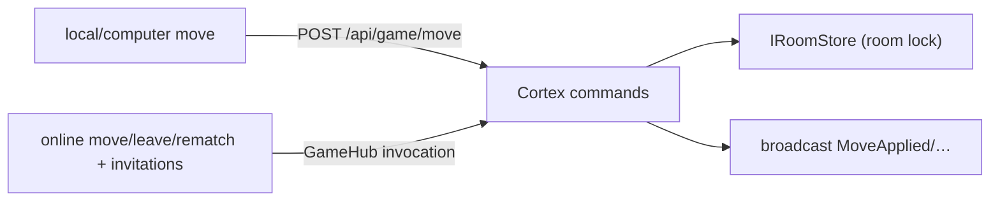

# ADR-0003: SignalR Hub as the Command Gateway

*Records why online mutations travel over the hub (not a REST moves endpoint), and why that asymmetry with local play is deliberate.*

**Status:** Accepted (2026-11-06) · **Amended 2026-11-07:** [ADR-0009](0009-invitations-replace-room-codes.md) replaced the room-code flow with invitations — the hub-gateway principle is unchanged, the `JoinRoom` invocation is gone (see ADR-0009). · **Referenced by:** `../system-architecture.md` · `../realtime-signalr.md` · ADR-0005 · `../../02-backend/cqrs-use-cases.md`

## Context

Online play needs two directions: players submit moves (leave/rematch + invitations too), and the opponent sees results instantly. Local/computer play needs only request/response. Two viable shapes existed:

- **Shape A (senior-suite default):** moves via REST (`POST /api/rooms/{code}/move`), SignalR purely for broadcast.
- **Shape B:** the hub is the command gateway — clients invoke hub methods, the hub dispatches Cortex commands and broadcasts outcomes.

The solo implementation follows the original docs' design (hub gateway), where the hub is explicitly a *thin command dispatcher* with zero rules/direct store access.

## Decision

**Shape B — hub as command gateway.**

- Hub methods (`MakeMove`, `Leave`, `RequestRematch`) only: authenticate → dispatch `IMediator` → broadcast the command's result ([../realtime-signalr.md](../realtime-signalr.md) §3). Room creation happens at invitation acceptance and the presence/invitation invocations (`GetOnlinePlayers`, `InvitePlayer`, `CancelInvitation`, `RespondToInvitation`) ride the same hub per [ADR-0009](0009-invitations-replace-room-codes.md) — no `JoinRoom` step exists anymore.
- Local play stays on the stateless JSON endpoint `POST /api/game/move` → `PlayMoveQuery` — no hub connection, no session.
- Connections/groups are managed as the transport concern: cookie-authenticated hub, `room-{id}` groups (internal opaque id, never user-facing) joined only after participant validation.

## Rationale (why B here)

1. **It plays to the instrument:** the online surface *must* be a persistent authenticated connection anyway; with cookie auth, the invoke path needs no additional CSRF/anti-forgery choreography or header plumbing for a game session.
2. **One reply, same channel:** the invoking player's outcome and the opponent's broadcast come from the same command result over one already-open socket; REST would need REST response plus a broadcast, two delivery paths to keep coherent.
3. **Thin hub ≠ smart hub:** the correctness mechanism is the per-room lock in `IRoomStore` — *not* the transport ([ADR-0005](adr/0005-in-memory-room-store.md)). The race-safety table holds identically under either shape ([../realtime-signalr.md](../realtime-signalr.md) §6), so Shape B is not a correctness downgrade.
4. **Solo rewrite cost:** adopting Shape A means reworking existing hub flows and `room.js` for zero behavioral delta at v1 scope. Race handling does not improve because, as stated, safety lives in the store lock.

## Consequences

**Positive:** fewer moving parts for online (no fetch layer for room state mutations); a single parity point for auth/participant validation; matches how the code was built and tested.

**Negative:** two transport flavors to learn (hub invocations vs MVC JSON); REST tooling (OpenAPI-style contract sharing) doesn't apply to the online path; perhaps a store-refactor later should REST-ify mutations if a real need appears — revisit as a new ADR, not silently.

**Neutral:** authentication carries over to both shapes via the same cookie; uniqueness of live room state is preserved either way.

## Alternatives considered

| Alternative | What it offered | Why deferred |
| --- | --- | --- |
| Shape A — REST moves + broadcast-only hub | REST orthodoxy, easier contract sharing, no invoke-side races | Zero product-behavior gain at this scale; rework cost; correctness still depends on the lock |

## Links

- Contract: [`../realtime-signalr.md`](../realtime-signalr.md)
- Concurrency: [`../realtime-signalr.md`](../realtime-signalr.md) §6

## Assumptions

- The hub stays thin: if a hub method ever grows board validation or DB logic, that is an architecture regression caught by review/tests, not a signal to move transports.
- Cookie state through the SignalR negotiate is unchanged by hosting (WebSockets + same-origin).
