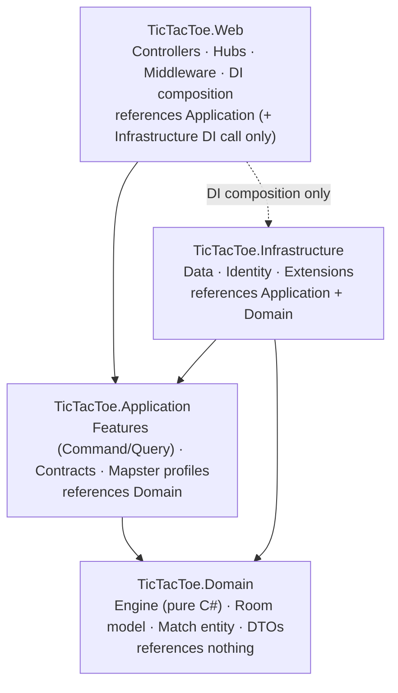
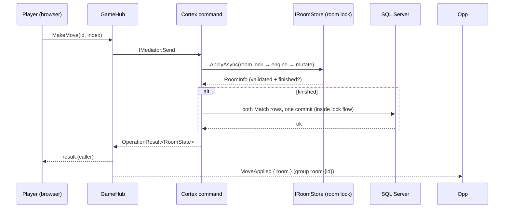

# Clean Architecture & DDD

*This document specifies the dependency rule, the per-project and folder-by-folder solution layout, the DDD tactical patterns applied to the Game bounded context, and how the layering is enforced by tests.*

Parent document: [PRD](../00-product/PRD.md) §4.3 · Related: [System architecture](system-architecture.md) · [CQRS & Mediator](cqrs-and-mediator.md) · [Real-time & SignalR](realtime-signalr.md) · Decision record: [ADR-0001](adr/0001-clean-architecture-with-mvc.md)

---

## 1. The Dependency Rule

Dependencies point inward only. The Domain references nothing; Application depends only on Domain; Infrastructure implements Application's abstractions; Web composes everything for DI. Frameworks, database and transport details live at the edge and are injected inward as interfaces owned by the Application (or Domain) layer.



What the rule buys this project:

| Benefit | Mechanism |
| --- | --- |
| Testable game rules | Engine (`Rules`, `Board`) is pure C# — unit-tested with no mocks, no DB, no clock (`IRandomSource` is passed in, [ADR-0006](adr/0006-pure-game-engine-in-domain.md)) |
| Swappable infrastructure | SQL Server, Identity, the room store, presence and invitations sit behind `IUnitOfWork`, `IAccountService`, `IRoomStore`, `IPresenceTracker`, `IInvitationManager` |
| Transport freedom | Commands arrive via the hub today and via the MVC JSON endpoint for local/computer play — the same handlers serve both; the hub contains zero rules ([ADR-0003](adr/0003-signalr-hub-as-command-gateway.md)) |
| Protected write model | Only Application handlers touch repositories and the room store; queries cannot load room state at all (read side uses projections) |

## 2. Projects and Responsibilities

| Project | Responsibility | References | Tests |
| --- | --- | --- | --- |
| `TicTacToe.Domain` | `Engine/` (Board, Player, Rules, GameResult), `Engine/Ai/` (IComputerPlayer, Easy/Medium/Hard), `Online/` (Room, RoomStatus, RoomPlayer), `Entities/Match`, `DTOs/`, `Contracts/` (`IRandomSource`), enums | none | `TicTacToe.Application.UnitTests` (engine must reach 100% line coverage, ADR-0006) |
| `TicTacToe.Application` | `Features/<Area>/<Feature>/Command` + `Query` (CQRS slices: `XxxCommand.cs` + `XxxCommandHandler.cs`), `Contracts/` (`IUnitOfWork`, `IRepository<T>`, `IMatchRepository`, `IRoomStore`, `ICurrentUser`, `IAccountService`, `IComputerPlayerFactory`), `Common/` (`Results/` — `OperationResult<T>`), `Mapping/` (Mapster `IRegister` profiles), `Settings/RoomSettings`, `Exceptions/` | Domain | `TicTacToe.Application.UnitTests` |
| `TicTacToe.Infrastructure` | `Data/` (ApplicationDbContext, UnitOfWork, Migrations/, Repositories/), `Identity/` (ApplicationUser, AccountService, CurrentUser), `Services/` (InMemoryRoomStore, PresenceTracker, InvitationManager, RoomCleanupService, ComputerPlayerFactory, SystemRandomSource), `Extensions/` (DependencyInjection) | Application, Domain | — (unit suite via Application seams) |
| `TicTacToe.Web` | Host: `Controllers/` (Home, Rooms, Account, History, Settings), `Hubs/GameHub` (thin command gateway), `Middleware/GlobalExceptionHandler`, Razor views, `wwwroot/{css,js,lib}`, auth setup, Serilog, DI composition root (`Program.cs`) | Application, Infrastructure (composition only) | — (real-server behaviour covered by manual walkthrough scripts) |

## 3. Folder-by-Folder Content Specification

The canonical solution layout (expands PRD §6.4 to file level). Every file below is part of the MVP build.

```text
src/
  TicTacToe.Domain/
    Contracts/
      IRandomSource.cs           — ONE randomness seam; faked in tests (R-A4)
    Engine/
      Board.cs                   — immutable 3×3 board; Move returns a new board
      Player.cs                  — X / O
      Rules.cs                   — ValidateMove / ApplyMove / Evaluate (static, pure)
      GameResult.cs              — Outcome (XWins/OWins/Draw), WinningLine
    Engine/Ai/
      IComputerPlayer.cs         — Player Mark; ChooseMove(Board)
      EasyAi.cs                  — random via IRandomSource
      MediumAi.cs                — deterministic: win-take, block, center, corner
      HardAi.cs                  — exhaustive minimax, always at least a draw
    Online/
      Room.cs                    — aggregate root: the in-memory online game
      RoomStatus.cs              — Playing / Finished / Closed (no Waiting state)
      RoomPlayer.cs              — child entity: UserId, Mark, disconnected-until
    Entities/
      Match.cs                   — the persisted match record (see §4)
    DTOs/                        — Game/ · Rooms/ · Matches/ (view & hub payload shapes)
    Enums/                       — GameMode, MatchResult, Difficulty
    Exceptions/                  — engine failure codes (E1–E6, ADR-0006) — the engine
                                   itself returns result values, never throws
  TicTacToe.Application/
    Contracts/
      IUnitOfWork.cs             — SaveChangesAsync() — the ONLY commit point
      IRepository.cs             — generic repository contract
      IMatchRepository.cs        — GetByUser / stats / delete-by-user
      IRoomStore.cs              — in-memory room access (ApplyAsync under per-room lock)
      ICurrentUser.cs            — caller identity from the Identity cookie
      IAccountService.cs         — password change / account deletion (account use cases)
      IComputerPlayerFactory.cs  — difficulty → IComputerPlayer
    Common/
      Results/                   — OperationResult<T>, Error (ADR-0010)
      Behaviors/                 — custom pipeline behaviors, added as reviewed code
                                   (ADR-0007); logging via Cortex defaults in v1
      Events/                    — notification handlers if domain events are ever
                                   introduced (none in v1 — see §7)
    Features/
      Game/
        Moves/
          Command/              — PlayMoveCommand.cs + PlayMoveCommandHandler.cs
                                  (local / vs-computer)
      Matches/
        History/
          Command/              — SaveMatchCommand.cs + SaveMatchCommandHandler.cs
                                  (forgery-checked by engine replay)
          Query/                — GetHistoryQuery.cs + GetHistoryQueryHandler.cs,
                                  GetStatsQuery.cs + GetStatsQueryHandler.cs
                                  (read-side projections to DTOs)
      Rooms/
        Invitations/
          Command/              — SendInvitationCommand.cs,
                                  CancelInvitationCommand.cs,
                                  RespondToInvitationCommand.cs
                                  (each + its Handler.cs)
          Query/                — GetOnlinePlayersQuery.cs +
                                  GetOnlinePlayersQueryHandler.cs
        Online/
          Command/              — MakeOnlineMoveCommand.cs, LeaveRoomCommand.cs,
                                  RequestRematchCommand.cs (each + its Handler.cs)
          Query/                — GetRoomQuery.cs + GetRoomQueryHandler.cs
      Account/
        Profile/
          Command/              — ChangePasswordCommand.cs, DeleteAccountCommand.cs
                                  (each + its Handler.cs)
    Mapping/                     — Mapster IRegister profiles (one per area)
    Settings/                    — RoomSettings (grace 60 s, invitation 30 s, cooldown 30 s,
                                   cleanup interval 5 s)
    Exceptions/                  — application-level exception types (expected failures
                                   are OperationResult values, ADR-0010 — rarely thrown)
    DependencyInjection.cs       — AddApplication(): contracts, validators,
                                   AddCortexMediator, Mapster registration
  TicTacToe.Infrastructure/
    Data/
      ApplicationDbContext.cs    — IdentityDbContext + Match mapping
      UnitOfWork.cs              — abstract base: SaveChangesAsync over the DbContext
      Repositories/
        Repository.cs            — generic Repository<T> base
        MatchRepository.cs       — : Repository<Match>, IMatchRepository
      Migrations/                — EF Core migrations + snapshot
    Identity/
      ApplicationUser.cs         — IdentityUser (cookie auth, no JWT — ADR-0004)
      AccountService.cs          — password change, account deletion (with forfeit-first rule)
      CurrentUser.cs             — ICurrentUser from claims
    Services/
      InMemoryRoomStore.cs       — IRoomStore; per-room locks (ADR-0005, ADR-0013)
      PresenceTracker.cs         — userId → connection count (ADR-0014)
      InvitationManager.cs       — pending invitations + guards (ADR-0009, ADR-0014)
      RoomCleanupService.cs      — BackgroundService; 5 s tick: forfeit / orphan-close /
                                   invitation expiry
      ComputerPlayerFactory.cs
      SystemRandomSource.cs
    Extensions/
      DependencyInjection.cs     — AddInfrastructure(configuration): DbContext, Identity,
                                   repositories, UnitOfWork, singletons, hosted service
  TicTacToe.Web/
    Program.cs                   — composition root: AddApplication() +
                                   AddInfrastructure(), cookie auth, MVC, SignalR,
                                   hub mapping, Serilog
    Hubs/
      GameHub.cs                 — /hubs/game: authenticate → dispatch IMediator →
                                   broadcast; zero rules, zero board logic
    Middleware/
      GlobalExceptionHandler.cs  — last-resort friendly page, logged with correlation id
    Controllers/                 — Home · Rooms · Account · History · Settings
                                   (Razor POSTs re-render with inline errors; one JSON
                                   endpoint for local/computer moves)
    Models/ · Views/ · wwwroot/{css,js,lib}
test/
  TicTacToe.Application.UnitTests/ — the ONE test project (ADR-0015): Engine tests,
                                   Features/<Area>/<Feature>/…HandlerTests, architecture tests
                                   — NUnit + Shouldly
docs/                            — this documentation set
```

## 4. DDD Tactical Mapping

| DDD concept | Implementation | Notes |
| --- | --- | --- |
| Bounded context | **Games** (local/computer), **Online** (rooms + invitations), supporting **Accounts** | Three contexts, one deployable; deliberately not split further (PRD over-engineering risk) |
| Aggregate root | `Room` (in-memory) | The consistency boundary for players, board state, grace and result while a game is live |
| Child entity | `RoomPlayer` | Exists only inside a `Room`; never persisted directly; no separate repository |
| Record entity (not aggregate) | `Match` | A saved row, written once at game end and never mutated; loaded/saved through `IMatchRepository` for history and stats |
| Value objects | `Board`, `Player`, `GameResult`, `Mark` | Immutable, value equality; `Board` is derived from the move list (single source of truth) |
| Domain events | none in v1 | The hub `RoomState` payload is the integration surface (see §7); `Common/Events/` is the home if events are ever introduced |
| Domain services | none needed | Win/draw evaluation is pure (`Rules.Evaluate`); cross-room coordination lives in handlers, not aggregates |
| Repository contracts | `IMatchRepository`, `IRoomStore` (**in Application**, not Domain) | Deliberate divergence from the classic DDD placement — see Assumptions |
| Ubiquitous language | §5 | Names appear verbatim in code, hub events and UI |

## 5. Ubiquitous Language Glossary

| Term | Meaning (as used in code, hub events and UI) |
| --- | --- |
| Game | One play session: local/computer, or an online `Room` |
| Match | A **saved** game record (result + move list), written once per player |
| Room | A live online game between two players, created only when an invitation is accepted |
| Invitation | A pending ask from one player to another; ~30 s lifetime; cancelled by silence, rejection or either party going offline |
| Mark | X or O — the symbol a player places (inviter is always X) |
| Board | The 3×3 grid (cells 0..8), derived from the move list |
| Move | A mark placed at a cell |
| Turn | The mark allowed to move next; X starts, then strict alternation |
| Online | Logged in with ≥ 1 live hub connection, on **any** page (site-wide presence, [ADR-0009](adr/0009-invitations-replace-room-codes.md)) |
| Available / Invited / In game | The three lobby statuses derived from presence + invitations + room state |
| Grace period | **60 seconds** after a player's last connection drops before forfeit is enforced (FR-29) |
| Forfeit | Ending a game because a player left/disconnected past grace; the opponent wins |
| Orphaned room | Both players gone past grace; closed by cleanup **without saving a result** (FR-30) |
| Result | Value object: Outcome (XWins/OWins/Draw), Reason (Normal/Forfeit), WinningLine |
| Lobby | What a player sees: the live online-player list with statuses (no open-games list — there are no joinable open games in v1) |

## 6. Behavior and Invariants

### 6.1 Behavior (methods / operations)

**Engine (pure rules, [ADR-0006](adr/0006-pure-game-engine-in-domain.md)):**

| Operation | Guard rules | Effect | Returns |
| --- | --- | --- | --- |
| `Rules.ValidateMove(board, index, mark, turn)` | index ∈ 0–8, cell empty, game unfinished, mover's mark matches the turn (E1) | Reports the first failing law, or legal | `EngineResult` (never throws) |
| `Rules.ApplyMove(board, index, mark)` | same guards as above | Returns a **new** board; the old board is never mutated | new `Board` |
| `Rules.Evaluate(board)` | exactly 8 win lines (E3); full board with no line = draw (E4) | Deterministic result (E6); a finished game rejects further moves (E5) | `GameResult` |
| `IComputerPlayer.ChooseMove(board)` | any non-full board (Easy uses `IRandomSource`; Medium deterministic; Hard minimax) | Returns a legal cell index | cell index |

**Room (in-memory lifecycle, [ADR-0005](adr/0005-in-memory-room-store.md) · [ADR-0009](adr/0009-invitations-replace-room-codes.md)):**

| Operation | Guard rules | Effect | Returns |
| --- | --- | --- | --- |
| Accept invitation | Inviter Available, target Available, no outgoing invitation, no cooldown (FR-36) | Room created atomically; inviter = X; game starts immediately (FR-34) | `OperationResult<RoomState>` |
| `MakeOnlineMove` | Status is Playing; caller is a participant; it is that player's turn; cell empty | Board updated via `Rules`; result finalized once if won/drawn | `RoomNotParticipant`, `Game.*` failures as values |
| Finish (win/draw or forfeit) | Room not already finished | Both `Match` rows written **once**, one transaction, inside the room-lock flow (FR-26) | success; second writer gets `Game.AlreadyOver` |
| Cleanup orphan | Both players past grace | Room closed **without saving any result** (FR-30) | success |

### 6.2 Invariants (enforced inside the engine and the room store)

1. A game has at most two players, and they are distinct.
2. Moves are accepted only while the game is Playing.
3. Turns alternate strictly, starting with X (the inviter / local player).
4. A cell can be marked exactly once per game.
5. A finished game is immutable — no further moves, leaves or rematches until a rematch resets the board.
6. Result is set exactly once, at the moment the game finishes.
7. The board is always derivable from the ordered move list (no redundant stored board).
8. Position domain is 0..8; anything outside is rejected before any state changes.

Backed at the database level by: the `Matches` table written exactly once per player per finished game ([Schema](../03-database/schema-and-erd.md)), and the per-room locks serializing every in-memory transition ([ADR-0013](adr/0013-per-room-locking-no-optimistic-concurrency.md)).

## 7. Broadcast Dispatch Design

Handlers mutate, the store serializes, and the hub broadcasts — **no broadcast may describe state that failed to commit, or that is still mid-lock**. There is no domain-event chain in v1: every mutation path ends in a handler that already holds the new `RoomState`, so the handler broadcasts directly after the lock is released. The hub contract stays explicit (13 events, [realtime-signalr.md](realtime-signalr.md) §4).



Design rules:

| Rule | Reason |
| --- | --- |
| Broadcast **after** lock release, never inside it | Observers must never see half-finished state; hold time stays at microseconds ([realtime-signalr.md](realtime-signalr.md) §5) |
| The handler returns the authoritative `RoomState`; the broadcast carries the **same payload** | One shape serves caller and observers; clients replace state, never merge ([realtime-signalr.md](realtime-signalr.md) §4) |
| Broadcast failures are logged, never thrown into the command | Push failure must not turn a successful move into a failure; clients resync via `GetRoomQuery` |
| The hub only authenticates, dispatches and broadcasts | Platform rule ([ADR-0003](adr/0003-signalr-hub-as-command-gateway.md)): any rule found in the hub is a defect |
| Exactly-once finish | The finish+save happens inside the same lock-held flow; the second writer sees `Game.AlreadyOver` ([realtime-signalr.md](realtime-signalr.md) §6) |

## 8. Enforcing the Layering (Architecture Tests)

The dependency rule is guarded by architecture tests **inside the unit suite** ([ADR-0015](adr/0015-vertical-slices-and-unit-only-tests.md)) — there is no separate architecture/integration project (unit-only floor, owner decision 2026-11-07):

| Rule | Enforcement |
| --- | --- |
| Domain purity | `TicTacToe.Domain` references no other project and no packages — only BCL |
| Application isolation | `TicTacToe.Application` may reference only `TicTacToe.Domain` (plus Cortex.Mediator/Mapster packages) |
| Infrastructure inward-only | `TicTacToe.Infrastructure` references only `TicTacToe.Application` and `TicTacToe.Domain` — never `TicTacToe.Web` |
| Web not referenced | no type in any layer references `TicTacToe.Web` |

These run on every build in CI alongside the unit suite ([CI/CD](../06-devops/deployment.md), [Testing strategy](../05-quality/test-strategy.md)). Real-server behaviour (cookie auth redirects, hub negotiate, two-browser races) is verified by the documented manual walkthrough scripts at milestone gates and the M13 sweep ([ADR-0008](adr/0008-nunit-moq-shouldly-testing.md)).

## Assumptions

- Repository interfaces stay in the Application project (implementation-consumed placement) rather than Domain; this deviates from the classic DDD placement and is a deliberate, recorded choice — Domain stays package-free by rule R-A5.
- `Match` is a write-once record, not an aggregate: it has no behaviour and is never loaded for mutation — which is why no optimistic concurrency is needed on it (ADR-0013).
- No domain events and no outbox in v1: broadcasts are direct hub calls from handlers, and broadcast loss is tolerable because clients resync via `GetRoomQuery` on reconnect.
- `Board` is a functional value object: the move list is the single source of truth for cell occupancy, and `Move` returns a new board instead of mutating.
