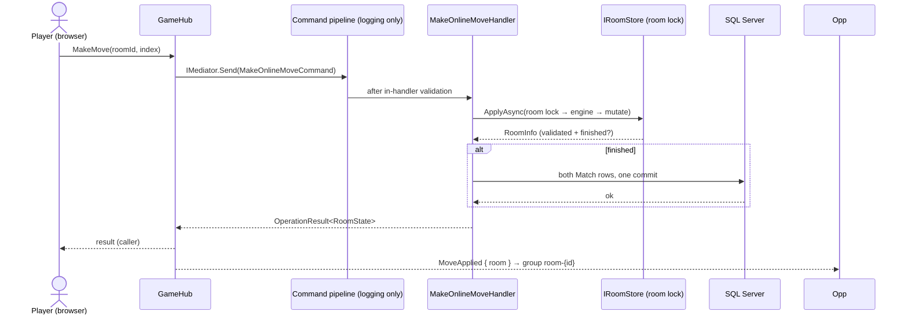

# CQRS & Mediator (Cortex.Mediator)

*The command/query separation for the platform, the full command and query catalog, the Cortex.Mediator pipeline, the `OperationResult<T>` pattern with error code conventions, and the handler-to-broadcast flow.*

Parent document: [PRD](../00-product/PRD.md) · Related: [Clean Architecture & DDD](clean-architecture-ddd.md) · [System architecture](system-architecture.md) · [Real-time & SignalR](realtime-signalr.md) · Decision records: [ADR-0007](adr/0007-cortex-mediator-mapster-serilog.md) · [ADR-0010](adr/0010-result-pattern-expected-failures.md) · [ADR-0015](adr/0015-vertical-slices-and-unit-only-tests.md)

---

## 1. CQRS Principles for This Project

CQRS here is a code-organization discipline, not a two-database system. The split is logical: **commands** mutate state through the engine, the room store and repositories; **queries** are read-only projections that never touch room state. [Cortex.Mediator](adr/0007-cortex-mediator-mapster-serilog.md) enforces the split at the type level: commands implement `ICommand<T>` and queries implement `IQuery<T>` — two separate handler families, not one shared request type.

| Principle | This project |
| --- | --- |
| Commands write, queries read — never both | Every use case is exactly one `ICommand<T>` or `IQuery<T>`; handlers never mix load-for-update with projection queries |
| Commands go through the engine | Every mutation path (hub, JSON endpoint, cleanup forfeit) validates through `Rules` — domain rules are unskippable ([ADR-0006](adr/0006-pure-game-engine-in-domain.md)) |
| Online state is lock-guarded, not aggregate-loaded | Online mutations run inside `IRoomStore.ApplyAsync` under the per-room lock ([ADR-0013](adr/0013-per-room-locking-no-optimistic-concurrency.md)); the online game finish writes both `Match` rows in the same lock-held flow |
| Queries project, never load rooms | History/stats query handlers project from the `Matches` table straight to DTOs — no room objects, no change tracking, no domain rules on the read path |
| One database for the MVP | Both sides hit the same SQL Server; CQRS introduces no extra store and no eventual consistency |
| Transport stays dumb | Controllers and the hub only create requests and map `OperationResult` to page/JSON/hub — they contain no business logic ([ADR-0003](adr/0003-signalr-hub-as-command-gateway.md)) |

Why not event sourcing: the aggregate is two players and at most nine moves; a relational `Matches` table is simpler to query, trivially auditable (FR-12), and needs no replay infrastructure. The hub payloads themselves are the real-time integration surface.

## 2. Command & Query Catalog

All commands/queries are dispatched through `IMediator` — from the `GameHub` for online use cases and from Razor controllers / the one JSON endpoint for the rest. The current user identity comes from `ICurrentUser` (Identity cookie claims), never from the payload. **Auth is deliberately not CQRS:** register/login/logout go directly through Identity (`IAccountService`) because they are framework calls, not domain use cases — that is the honest divergence from the seniors' catalog.

| Kind | Request | Inputs | Returns | Transport |
| --- | --- | --- | --- | --- |
| Command | `PlayMoveCommand` | index (local/computer game) | `OperationResult<GameDto>` | JSON endpoint (`PlayMoveCommand` path) |
| Command | `SaveMatchCommand` | move list + claimed result | `OperationResult` | Razor POST (forgery-checked by engine replay, `Game.ForgedResult`) |
| Command | `SendInvitationCommand` | target `userId` | `OperationResult<InvitationState>` | Hub `InvitePlayer` |
| Command | `CancelInvitationCommand` | `invitationId` | `OperationResult` | Hub `CancelInvitation` |
| Command | `RespondToInvitationCommand` | `invitationId`, `accept` | accept → `OperationResult<RoomState>` · reject → `OperationResult` | Hub `RespondToInvitation` |
| Command | `MakeOnlineMoveCommand` | `roomId`, `index` | `OperationResult<RoomState>` | Hub `MakeMove` |
| Command | `LeaveRoomCommand` | `roomId` | `OperationResult` | Hub `Leave` (forfeit semantics) |
| Command | `RequestRematchCommand` | `roomId` | `OperationResult<RoomState>` | Hub `RequestRematch` |
| Command | `ChangePasswordCommand` | current + new password | `OperationResult` | Razor POST (`Auth.WrongPassword`) |
| Command | `DeleteAccountCommand` | — (current user) | `OperationResult` | Razor POST (forfeit-first, then cascade delete — [ADR-0013](adr/0013-per-room-locking-no-optimistic-concurrency.md)) |
| Query | `GetRoomQuery` | `roomId` | `OperationResult<RoomState>` | Hub reconnect + room page |
| Query | `GetOnlinePlayersQuery` | — | `OperationResult<IReadOnlyList<OnlinePlayerDto>>` | Hub lobby list |
| Query | `GetHistoryQuery` | current user | `OperationResult<IReadOnlyList<MatchHistoryItem>>` | Razor page |
| Query | `GetStatsQuery` | current user | `OperationResult<PlayerStats>` | Razor page |

Handlers implement `ICommandHandler<TCommand, TResponse>` / `IQueryHandler<TQuery, TResponse>` with `Task<TResponse> Handle(T request, CancellationToken cancellationToken)`.

### 2.1 Why commands return `RoomState` in this MVP

Online commands return the full `RoomState` rather than a bare acknowledgement for three practical reasons: (1) the caller's client updates immediately from the authoritative response and does not wait for its own SignalR echo; (2) after a move the board, current turn and possibly the result have all changed, and `RoomState` carries exactly that reconciled state — the same shape the hub broadcasts, so one client model serves both channels; (3) it eliminates a follow-up `GetRoomQuery` on the hot path (helping the p95 < 500 ms move budget, [realtime-signalr.md](realtime-signalr.md) §8). The cost is one Mapster projection per command — negligible against the lock acquisition and save it follows.

## 3. Mediator Pipeline (Cortex.Mediator)

Cortex.Mediator has **separate pipelines for commands, queries and notifications**. This project's pipeline is deliberately boring: **only Cortex's logging behavior is enabled** ([ADR-0007](adr/0007-cortex-mediator-mapster-serilog.md) ground rule 2 — pipeline magic is not free behavior on by default).

| # | Concern | Implementation | Scope | On failure |
| --- | --- | --- | --- | --- |
| 1 | Logging | Built-in `LoggingCommandBehavior` / `LoggingQueryBehavior` (registered by default behaviors) — request type, user id, elapsed ms | commands, queries | Passes exceptions through after logging them |
| 2 | Validation | **Explicit, in the handler** — each slice injects its `IValidator<T>` and runs it as the first statement | commands, queries | Returns `OperationResult.Failure(Validation.Error)`; nothing is persisted |
| 3 | Unit of work | **Handler-owned `IUnitOfWork.SaveChangesAsync()`** — no pipeline behavior | commands only | Commit failure → logged + friendly failure; no broadcast is sent |
| 4 | Performance | **Logging threshold only** — the logging behavior's elapsed-ms warning is the slow-use-case signal; no separate performance behavior | commands, queries | Never fails the request |

Why the deliberate gaps (recorded so a reviewer never "fixes" them):

- **No UnitOfWork pipeline behavior.** Local/computer moves and invitation commands write nothing to SQL; the one SQL-writing command (`SaveMatchCommand` and the online finish) owns its commit explicitly, because the online finish must commit *inside* the room-lock flow — a pipeline behavior sitting outside the lock could not do that. Handler-owned commits are the rule stated in [system-architecture.md](system-architecture.md) §5.4.
- **No performance behavior.** A custom performance behavior would duplicate the logging behavior's second timer for no new information.

Performance in the logging behavior is the warning mechanism; Cortex's optional exception-handling behaviors are **not** enabled — unexpected-exception translation stays in the Web layer's `GlobalExceptionHandler` (the single mapping point).

Registration sketch (`Infrastructure/Extensions/DependencyInjection.cs` — all DI lives in Infrastructure;
Application has no DI file and no `Microsoft.Extensions.DependencyInjection` reference) — logging behaviors only.
Verified at M0: `AddCortexMediator` lives in `Cortex.Mediator.DependencyInjection` and takes `Type[]` marker types, not assemblies:

```csharp
services.AddCortexMediator(
    new[] { typeof(ApplicationAssemblyMarker) },   // marker in TicTacToe.Application
    options =>
    {
        options.AddDefaultBehaviors();  // logging behaviors only — ADR-0007
    });
services.AddMapster();
```

Behavior note: logging observes everything; the concerns and their order are the contract.

### 3.1 Handler-owned commit (sketch)

```csharp
public async Task<OperationResult<RoomState>> Handle(MakeOnlineMoveCommand command,
    CancellationToken ct)
{
    var result = await _store.ApplyAsync(command.RoomId, async () => await _engine.ApplyAsync(command, ct));
    if (result.IsSuccess && result.Value.Finished)
        await _unitOfWork.SaveChangesAsync(ct);  // both Match rows, one commit — inside the lock flow
    return result;
}
```

Registered nowhere as a behavior — **each handler calls the commit itself**, so queries (read-only projections) never open a unit of work, and the online finish commits *inside* the room lock.

### 3.2 In-handler validation (sketch)

```csharp
var validation = await _validator.ValidateAsync(command, ct);
if (!validation.IsValid)
    return OperationResult.Failure(Error.ValidationError(validation.Errors));
```

One explicit line as the first statement of every handler — validation is reviewable in the slice, never hidden in the pipeline.

## 4. `OperationResult<T>` Pattern

Expected failures are values, not exceptions. Handlers return `OperationResult<T>`; only truly exceptional conditions (DB down, bugs) surface as exceptions. Full rationale: [ADR-0010](adr/0010-result-pattern-expected-failures.md).

| Member | Shape | Notes |
| --- | --- | --- |
| `OperationResult` / `OperationResult<T>` | `IsSuccess`, `Value` (T), `Error { Code, Message }` | Static factories: `.Success(value)` / `.Failure(code, message)` |
| Error codes | `Area.Reason` dotted names, asserted verbatim in tests | One literal message per code; the catalog is the single source of truth |
| Unexpected exceptions | Propagate to `GlobalExceptionHandler` → logged + friendly generic failure | Never swallowed by handlers |

### 4.1 Error code conventions

| Category | Code prefix | Examples | HTTP mapping |
| --- | --- | --- | --- |
| Validation (shape) | `Validation.` | `Validation.Error` | 400 |
| Auth | `Auth.` | `Auth.InvalidCredentials`, `Auth.LockedOut`, `Auth.DuplicateEmail`, `Auth.DuplicateUsername`, `Auth.WrongPassword` | 401 / 423 / 409 |
| Game rules (expected) | `Game.` | `Game.NotYourTurn`, `Game.CellOccupied`, `Game.AlreadyOver`, `Game.InvalidCell`, `Game.ForgedResult` | 409 / 422 |
| Rooms | `Room.` | `Room.NotFound`, `Room.Expired`, `Room.NotParticipant`, `Room.AlreadyActive` | 404 / 409 |
| Invitations | `Invite.` | `Invite.Self`, `Invite.Offline`, `Invite.Busy`, `Invite.Cooldown`, `Invite.AlreadyPending`, `Invite.Forbidden` | 400 (`Self`) / 403 (guest) / 409 |

HTTP/JSON mapping for the one JSON endpoint: `Room.NotFound` 404 · `NotYourTurn/CellOccupied/AlreadyOver/Invite.Cooldown` 409 · `ForgedResult` 422 · `Auth.InvalidCredentials` 401 · `Validation.Error` 400, with body `{"error":{"code","message"}}`. Razor POSTs ignore HTTP statuses and re-render forms with inline fields; the hub returns the `OperationResult` object directly. The canonical copy lives in `02-backend/error-handling.md` (next unit) and ADR-0010 — new codes are added there and to tests in the same change.

## 5. Handler → Broadcast Flow

There are **no domain events and no `INotification` handlers** in v1 (see [clean-architecture-ddd.md](clean-architecture-ddd.md) §7 for the placement rationale, [ADR-0003](adr/0003-signalr-hub-as-command-gateway.md)). The handler is the end of the chain: after the mutation commits, the hub performs the broadcast with the same `RoomState` payload the command returned.



Broadcast catalog (one per trigger, all emitted directly from handlers — the "notification" of a mutation is simply the hub call that follows it):

| Event | Handler action | Recipients |
| --- | --- | --- |
| `MoveApplied` | `MakeOnlineMoveCommand` → hub broadcast `{ room }` after lock release | group `room-{id}` (both players) |
| `PlayerLeft` / `PlayerDisconnected` / `PlayerReconnected` / `RoomClosed` | `LeaveRoomCommand` / presence hook / `RoomCleanupService` → broadcast `{ room }`, `{ id, secondsLeft }`, `{ id }`, `{ id, reason }` | group `room-{id}` |
| `RematchStarted` | `RequestRematchCommand` (both-ready) → broadcast `{ room }` | group `room-{id}` |
| `OnlinePlayersUpdated` | presence connect/disconnect/status change → broadcast `{ players }` | each signed-in user's connections (every page) |
| `InvitationReceived` / `InvitationAccepted` / `InvitationDeclined` / `InvitationExpired` / `InvitationCancelled` | `SendInvitationCommand` / `RespondToInvitationCommand` / expiry & offline hooks → per-user broadcasts | inviter's and invitee's connections |

Clients replace state from the payload; they never merge, so duplicate or reordered broadcasts are harmless without needing idempotency machinery. The full event contract is [realtime-signalr.md](realtime-signalr.md) §4.

## Assumptions

- **Cortex.Mediator is pinned to 3.1.2** ([ADR-0012](adr/0012-pinned-stable-stack.md)); upgrades are deliberate, not incidental, and a major-version jump gets its own ADR.
- The dispatch surface is `SendAsync` / `QueryAsync` (type inference picks the registered handler); exact open-behavior registration overload names are verified against the package README at M0 and this section is updated if they differ.
- Because handlers own commits and validation explicitly, no command pipeline behavior wraps the handler: an exception thrown inside a handler is never swallowed by a custom behavior — it reaches `GlobalExceptionHandler`.
- Handler-to-broadcast is synchronous and in-process; a failed broadcast is logged but never fails the command (clients resync via `GetRoomQuery` on reconnect).
- The error-code table above is the v1 contract; new codes must be added to this table, [ADR-0010](adr/0010-result-pattern-expected-failures.md) and the catalog (next unit) before use.
