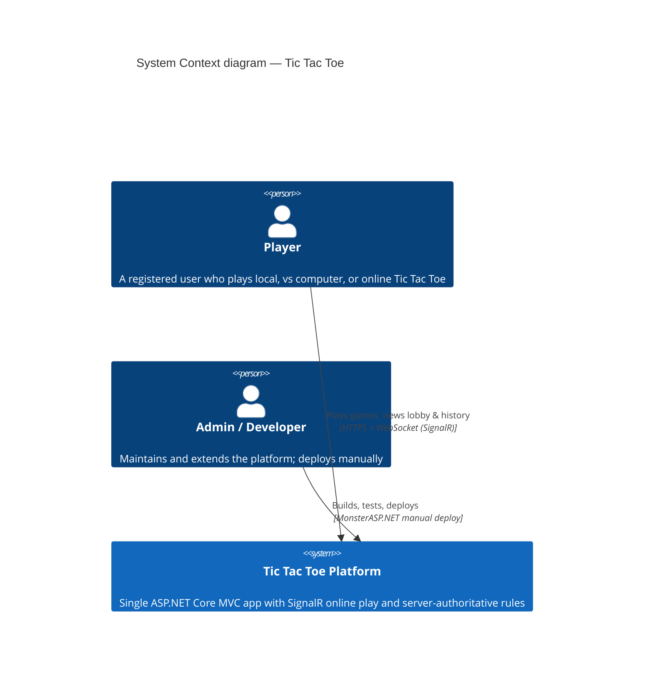
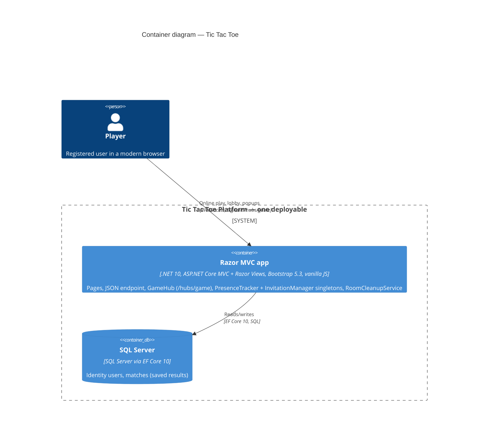
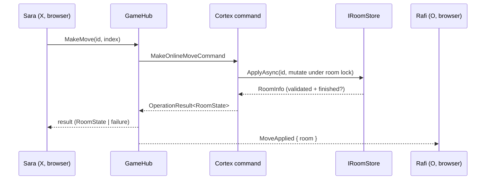
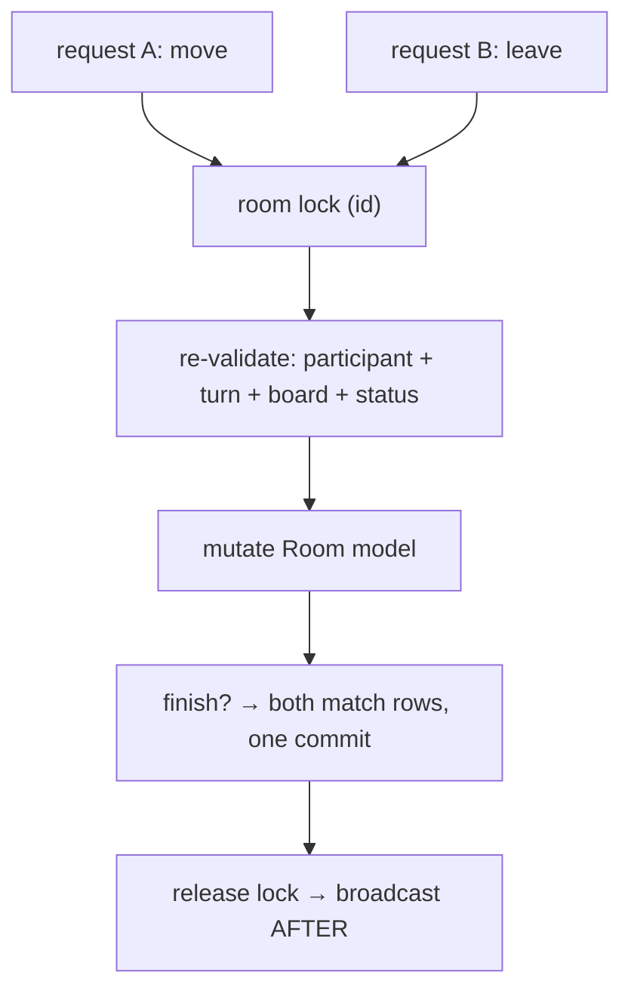
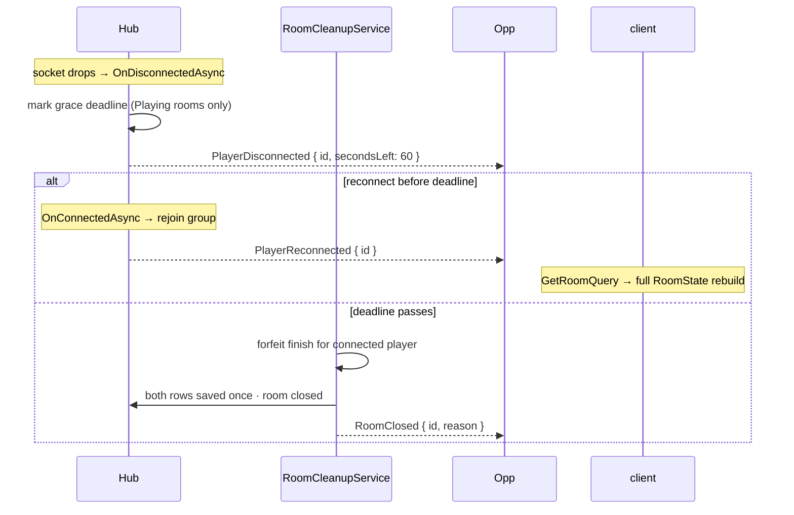
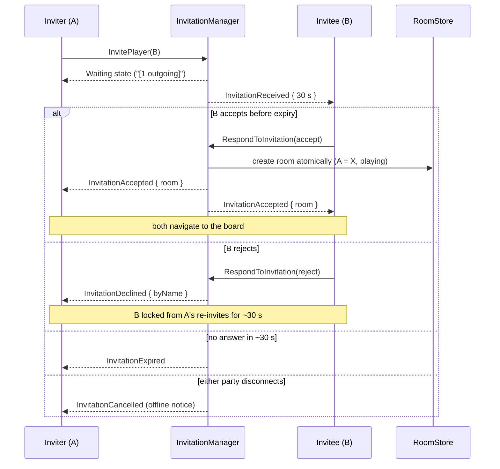

# Real-Time Architecture (SignalR)

*How online play stays instant and honest — the hub contract, the per-room lock, and the race-safety guarantees every concurrent client can rely on.*

Parent document: [PRD](../00-product/PRD.md) §4.3 · Related: [System architecture](system-architecture.md) · [Clean Architecture & DDD](clean-architecture-ddd.md) · [CQRS & Mediator](cqrs-and-mediator.md) · Decision records: [ADR-0003](adr/0003-signalr-hub-as-command-gateway.md) · [ADR-0009](adr/0009-invitations-replace-room-codes.md)

---

**System context & containers — in one picture.** The platform is a self-contained web product: registered players interact with it through a browser; the only external dependency is the SQL Server data store. There are no third-party integrations in v1. Online play is a **channel inside the same app**, not a separate service: the `GameHub` and the Razor pages live in one process, share one Identity cookie, and funnel into the same Cortex commands ([ADR-0003](adr/0003-signalr-hub-as-command-gateway.md)).

Key architectural facts (the contract the rest of this file expands):

| Fact | Value | Reference |
| --- | --- | --- |
| Game state authority | Server only — clients never mutate shared state | [PRD NFR Reliability](../00-product/PRD.md) |
| Write path | Hub invocations → Cortex commands; JSON endpoint for local/computer only | §1 below · [ADR-0003](adr/0003-signalr-hub-as-command-gateway.md) |
| Push path | SignalR hub `/hubs/game`; groups `room-{id}` + per-user events; site-wide presence | §4 below |
| Concurrency | Per-room / per-invitation locks; no optimistic concurrency | §5 below · [ADR-0013](adr/0013-per-room-locking-no-optimistic-concurrency.md) |
| Background work | `RoomCleanupService` hosted service (5 s tick: forfeits, orphaned rooms, invitation expiry) | §7 below |
| Live state | In-memory singletons (rooms, presence, invitations) — single instance by construction | [ADR-0014](adr/0014-in-memory-state-trio.md) |
| Testing | Unit-only suite; real-server behaviour via manual walkthrough scripts | [ADR-0015](adr/0015-vertical-slices-and-unit-only-tests.md) |

## 1. Transport model

Two transports deliberately coexist ([ADR-0003](adr/0003-signalr-hub-as-command-gateway.md)):

| Transport | Serves | Why |
| --- | --- | --- |
| `GameHub` invocations | **Online** mutations (invitations/move/leave/rematch) + all broadcasts | Persistent authenticated connection; instant push both ways |
| `POST /api/game/move` | **Local & vs-computer** moves (`PlayMoveQuery`) | Stateless single request; no hub connection needed offline |

Both funnel into the **same Cortex commands** — the hub contains zero rules, zero board logic.

## 2. Connection & auth

- Endpoint `/hubs/game`, `[Authorize]` — the Identity cookie authenticates the hub negotiate exactly as it authenticates pages.
- **Logged-in players keep one connection on every page of the site** (2026-11-07) — this is what makes the invitation popup work wherever the invitee is ([ADR-0009](adr/0009-invitations-replace-room-codes.md)). Room pages additionally join group `room-{id}`; other pages only register presence.
- Connection lifetime: opened after login on any page; auto-reconnect with backoff (client policy ≤ 30 s); on reconnect, a room client re-fetches `GetRoomQuery` and rejoins the group — **the server never trusts a client's memory of the game**.
- Presence rule: a user is **online** while ≥ 1 live connection exists; when the last connection drops they flip to offline immediately (delivering the offline notice wherever needed, e.g. pending invitation cancellation, [FR-35](../00-product/PRD.md)).
- Group model: one group per room, name `room-{id}`, derived **only** server-side from the validated internal room id — clients never name or join groups directly.

## 3. Client → hub invocations

Every invocation returns an `OperationResult`-shaped object (`{ isSuccess, value?, error?: { code, message } }`).

**Rooms & play:**

| Invocation | Args | Returns | Guards (in command, not hub) |
| --- | --- | --- | --- |
| `MakeMove` | `id`, `index` | `RoomState` | Participant + turn + engine legality (engine call) · `Room.NotParticipant`, `Game.*` |
| `Leave` | `id` | success | Participant · forfeit semantics per state · `Room.NotParticipant` |
| `RequestRematch` | `id` | `RoomState` | Both-ready rule · `Room.NotParticipant` |

**Presence & invitations (2026-11-07, [ADR-0009](adr/0009-invitations-replace-room-codes.md)):**

| Invocation | Args | Returns / effect | Guards |
| --- | --- | --- | --- |
| `GetOnlinePlayers` | — | list of `{ userId, displayName, status: Available \| Invited \| In game }` | Registered only · status derived from PresenceTracker + InvitationManager + room store |
| `InvitePlayer` | `userId` | `InvitationState` (waiting) | Guard set per FR-36: not self · target online + Available · inviter has **no outgoing invitation** · target not on rejection cooldown · `Invite.Self/Offline/Busy/Cooldown/AlreadyPending` |
| `CancelInvitation` | `invitationId` | success | Only the inviter cancels · clears state for both parties |
| `RespondToInvitation` | `invitationId`, `accept: bool` | accept → `{ room: RoomState }` · reject → success | Only the target responds · accept is **exactly-once atomically** (create room, flip invitation, notify) · invitation races handled in §6 |

**Hub iron rule (unchanged):** the hub only (1) authenticates, (2) dispatches `IMediator`, (3) broadcasts command results. Presence/invitation logic lives in the managers, dispatched through commands.

## 4. Hub → client events

Broadcast payloads are camelCase JSON. Event names are exactly these **thirteen** — the frontend has no vocabulary beyond them:

**Rooms & play** (group `room-{id}`; server-derived group names only):

| Event | Payload | Meaning |
| --- | --- | --- |
| `MoveApplied` | `{ room: RoomState }` | Board/turn/result after each accepted move (first-class: replaces the board wholesale) |
| `PlayerLeft` | `{ room: RoomState \| null }` | `null` = room closed |
| `PlayerDisconnected` | `{ id, secondsLeft }` | Grace countdown started (~60 s) |
| `PlayerReconnected` | `{ id }` | Grace cancelled |
| `RoomClosed` | `{ id, reason: "forfeit" \| "left" }` | Terminal cleanup |
| `RematchStarted` | `{ room: RoomState }` | Board reset with X to start |

**Presence & invitations** (per-user, delivered on **every page** where the signed-in player holds a connection):

| Event | Payload | Meaning |
| --- | --- | --- |
| `OnlinePlayersUpdated` | `{ players: [...] }` | Presence list refresh (connect, disconnect, status change) |
| `InvitationReceived` | `{ invitationId, fromUserId, fromName, expiresInSeconds: 30 }` | Show the Accept/Reject popup |
| `InvitationAccepted` | `{ invitationId, room: RoomState }` | Both parties navigate to the board |
| `InvitationDeclined` | `{ invitationId, byName }` | Inviter sees "[name] declined." |
| `InvitationExpired` | `{ invitationId }` | Inviter notified (~30 s no answer) |
| `InvitationCancelled` | `{ invitationId }` | Invitee dismissed; inviter cancelled |

`RoomState` is the single source of truth on the wire: `id, status, board, turn, players, result?, secondsToReconnect?` (status is `Playing/Finished/Closed` — a `Waiting` state no longer exists inside rooms, [ADR-0009](adr/0009-invitations-replace-room-codes.md)). Clients **replace** their state with the payload — no local merging, no diffing.

## 5. The concurrency spine — per-room lock

All room state flows through `IRoomStore.ApplyAsync(id, mutation)`; inside the store, **every mutation runs while holding that specific room's lock object** (registered in ADR-0005; full concurrency stance in [ADR-0013](adr/0013-per-room-locking-no-optimistic-concurrency.md)).

Order matters: **lock → validate → mutate → commit → release → broadcast.** Broadcasting after release keeps hold time at microseconds and keeps observers from seeing half-finished state.

`RoomInfo` = the command's answer to "did this move finish the game?" — when true, the handler persists the two match rows inside the same lock-held flow, guaranteeing exactly-once saving ([FR-26](../00-product/PRD.md)).

## 6. Race-safety contract

Each row's decision logic is **unit-tested** (store/invitation-manager level, mocked seams, fake time — [ADR-0008](adr/0008-nunit-moq-shouldly-testing.md)); its real-connection manifestation is verified by the documented **manual two-browser walkthrough scripts** ([`../05-quality/test-plan.md`](../05-quality/test-plan.md) §concurrency):

| # | Race | Guarantee | Mechanism |
| --- | --- | --- | --- |
| 1 | Two users join simultaneously | ~~Exactly one becomes O~~ **carried into the invitation flow:** a player already Invited (in either direction) is re-guarded, so no double-booking exists | Guard set re-evaluated inside `InvitationManager` under its lock ([ADR-0009](adr/0009-invitations-replace-room-codes.md)) |
| 2 | Double-click / two tabs by the same player | Second attempt gets `Game.NotYourTurn` or `Game.CellOccupied`; nothing broadcasts | Lock + re-validate both turn and board |
| 3 | Join racing a leave | First writer wins; the loser receives a coherent state, never a torn one | Both transitions inside the same lock |
| 4 | Reconnect vs 60 s expiry firing | Exactly one outcome: timer cancelled (return) **or** forfeit finish (expiry) — never both | Monotonic status transitions (R1/R2) + lock |
| 5 | Winning move vs cleanup pass forfeit | The room finishes **once**; one save path | Finish guarded under the lock; idempotent status check |
| 6 | Rematch click ×2 + late move | Rematch only when both flags set; a stale move rejected | Flags under lock; `Game.AlreadyOver` until playing |
| 7 | Two players invite each other simultaneously (A→B, B→A) | Exactly one invitation is created; the other fails with a clear "already pending" result — no deadlock, no stale superseded invitation | `InvitationManager` creates invitations serially under its lock; second guard re-reads fresh state |
| 8 | Accept vs the ~30 s expiry / vs a cancel | **Exactly once semantics:** if accept is processed first, room exists and the expiry/cancel is a no-op; if expiry/cancel wins, the late accept fails — never a room without an active invitation, never two rooms | Atomic accept inside the manager lock (invitation state + room creation, one flow) |
| 9 | Invitee accepts & goes offline mid-game at once | Invitation flows never revive a closed invitation; the room's own rules (grace/forfeit) take over from the moment the room exists | Invitation terminal states are monotonic; room lifecycle is separate |
| 10 | Presence flip racing an invite (target disconnects as invite lands) | If the invite registered first, target shows Invited; disconnect then cancels the invitation with the offline notice ([FR-35](../00-product/PRD.md)). If disconnect won, the invite fails as offline | Guard order: presence check inside the same manager lock that creates the invitation |

The failure mode *not* accepted: any heuristic fix (`if-else`, retry, client-side dedupe) outside the lock. Races are solved by serialization, not cleverness.

## 7. Disconnect & reconnection flow

Implemented in `RoomCleanupService` (5-second tick, fake-time testable, one try/catch per iteration so one bad room never stalls others). Full lifecycle: [`../02-backend/room-invitation-lifecycle.md`](../02-backend/room-invitation-lifecycle.md).

## 8. Performance envelope, deployment & scalability

| Metric | Budget | Where measured |
| --- | --- | --- |
| Move round-trip p95 (click → opponent board updated) | < 500 ms | Manual two-browser timing check (M4 gate, M7 sweep) |
| Opponent-move latency once `MoveApplied` fires (server → client paint) | < 100 ms typical | Manual two-browser timing |
| Lock hold time per mutation | µs (no I/O inside locks except the orchestrated finish) | Store unit tests |
| Connection count on free plan | ≥ 200 concurrent authenticated | M0 spike + load check |

Room and presence/invitation channels stay separate: the invitation ends the moment a room exists, and the room's own disconnect/forfeit rules take over.

### Deployment shape

One instance, forever (v1): rooms, presence and invitations live in memory (ADR-0005/0014); a restart legitimately ends in-progress games and pending invitations while finished `Match`es persist in SQL (FR-15). **MonsterASP.NET manual deploy** by the owner; agents never deploy. EF migrations apply on deploy; WebSockets must be enabled on the host (verified in M0 via the `spikes/SignalRCheck` throwaway). TLS terminates at the host (Let's Encrypt); the app itself never does TLS. Full runbook → [`../06-devops/deployment.md`](../06-devops/deployment.md).

### Scalability outlook

| Concern | Position for the MVP | Path beyond MVP |
| --- | --- | --- |
| API process | Single instance by construction — all live state is the in-memory trio; **this is the documented constraint**, not an accident | Scale out only when presence/invitations/rooms move to Redis-backed stores |
| Rooms / invitations throughput | Per-room and per-invitation locks: 100+ independent rooms never contend; hold time is microseconds | Vertical headroom first (host plan), then the Redis step |
| SignalR fan-out | Single-node groups; broadcasts carry full `RoomState` so any reconnect resyncs from `GetRoomQuery` | Redis backplane so any server can reach `room-{id}` groups |
| Presence | In-memory `userId → connectionCount` — correct for one instance | Replace `IPresenceTracker` implementation with a Redis-backed store; consumers unchanged ([ADR-0014](adr/0014-in-memory-state-trio.md)) |
| Disconnect timers | `RoomCleanupService` in-process (5 s tick) | Durable timers in Redis with idempotent expiry handling |
| Database | History/stats queries are read-side projections over `Matches` | Read replicas only if history load ever justifies it; CQRS already isolates queries behind repositories |

## Assumptions

- The **thirteen-event** vocabulary is **closed** for v1: adding an event name requires updating this file and `room.js`/`lobby.js` together (build-time-checked shared constants, not strings in two places).
- Setup assumptions stand: hub-to-command wiring assumes bursts of ≤ a few requests per room/invitation per second; per-room (and per-invitation) locking makes throughput linear; 100+ independent rooms/invitations never contend.
- `OperationResult` serialization over the hub is accepted as a plain JSON object (no typed client contract) — `room.js`/`lobby.js` own parsing; a mismatch surfaces in the manual two-browser walkthrough (payload assertions are unit-level where the hub wraps command results directly).
- Presence is best-effort-real-time (~2 s worst-case flip latency) — sufficient for invitations because guards are re-validated server-side at invite time, never trusted from the list display.
- Invitation expiry and the rejection cooldown both use the injected `TimeProvider` (fake-time testable, [ADR-0009](adr/0009-invitations-replace-room-codes.md)).
- Cross-link targets in `02-backend` are written in their own unit; the links above resolve to them.
