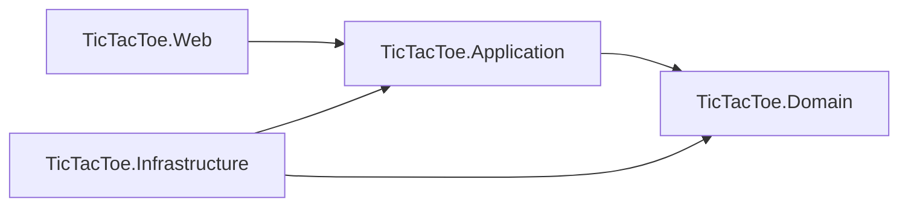
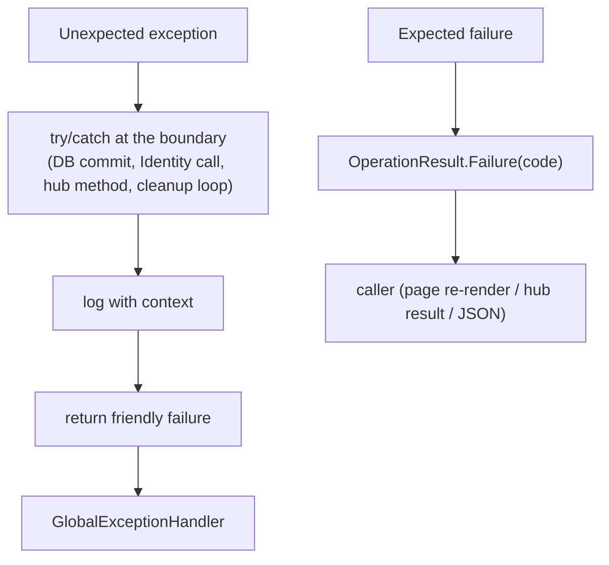

# System Architecture

*How Tic Tac Toe v1.0 is structured — projects, dependency rules, seams and cross-cutting conventions that make the product testable and boring to maintain.*

Parent document: [PRD](../00-product/PRD.md) · Related: [Clean Architecture & DDD](clean-architecture-ddd.md) · [CQRS & Mediator](cqrs-and-mediator.md) · [Real-time & SignalR](realtime-signalr.md) · Command/query catalog → [`../02-backend/cqrs-use-cases.md`](../02-backend/cqrs-use-cases.md) · Decision records: [ADR-0001](adr/0001-clean-architecture-with-mvc.md) … [ADR-0015](adr/0015-vertical-slices-and-unit-only-tests.md)

---

## 1. Stack (fixed)

| Concern | Choice | Version / note |
| --- | --- | --- |
| Runtime & framework | .NET 10 · ASP.NET Core MVC (Razor Views) | Single server-rendered app; no API project split |
| Front end | Vanilla JS ES modules + Bootstrap 5.3 | No SPA framework; each module ≤ 15 KB |
| Real time | ASP.NET Core SignalR | Online play only |
| Data | SQL Server via EF Core 10 | Local dev: SQL Server Express + SSMS |
| Auth | ASP.NET Core Identity, cookie auth | Same cookie authorizes the hub |
| CQRS | Cortex.Mediator | 3.1.2 (MIT), replaces MediatR |
| Mapping | Mapster | 10.0.14 + Mapster.DependencyInjection |
| Logging | Serilog | Serilog.AspNetCore 10.0.0; console + rolling file |
| Tests | NUnit · Moq · Shouldly · Autofac.Extras.Moq | **one suite (unit-only)** in `test/TicTacToe.Application.UnitTests` — see [`../05-quality/test-strategy.md`](../05-quality/test-strategy.md) |
| CI / host | GitHub Actions · MonsterASP.NET | owner deploys manually; agents never deploy |

Versions are pinned centrally in `Directory.Packages.props` (Central Package Management) — see [ADR-0012](adr/0012-pinned-stable-stack.md) for the full pin list and upgrade policy. **Any new package is an ADR-worthy decision** — never an opportunistic `dotnet add package`.

## 2. Projects & the dependency rule



Arrows point **inward only**. `Domain` references nothing. `Web` references `Infrastructure` solely to call its DI registration extension in `Program.cs` — never to use its types.

| Project | Owns | May reference |
| --- | --- | --- |
| `TicTacToe.Domain` | Entities (`Match`), online model (`Room`, `RoomStatus`, `RoomPlayer`), enums, DTOs, the **pure engine** in `Engine/` (+ `Engine/Ai/`), `IRandomSource` | **nothing** (zero NuGet packages) |
| `TicTacToe.Application` | Cortex commands/queries + handlers + validators, `OperationResult<T>`, Mapster profiles, contracts: `IRepository<T>`, `IMatchRepository`, `IUnitOfWork`, `IRoomStore`, `ICurrentUser`, `IAccountService`, `IComputerPlayerFactory`, `RoomSettings` | Domain |
| `TicTacToe.Infrastructure` | `ApplicationDbContext` + migrations, repositories, `UnitOfWork`, Identity (`ApplicationUser`, `AccountService`, `CurrentUser`), `InMemoryRoomStore`, `RoomCleanupService`, `ComputerPlayerFactory`, `SystemRandomSource` | Application + Domain |
| `TicTacToe.Web` | Controllers (Home, Rooms, Account, History, Settings), `GameHub`, Razor views, `wwwroot/{css,js,lib}`, `GlobalExceptionHandler`, `Program.cs`, `appsettings*.json` | Application (+ the one Infrastructure DI call) |

**Hard rules (each enforced by an architecture test, not by hope):**

| Rule | Statement | Failure it prevents |
| --- | --- | --- |
| R-A1 | Dependency arrows only point inward | Business logic that can't run without a web server |
| R-A2 | `Domain/Engine/` contains no I/O, no ASP.NET/EF/SignalR types, no NuGet deps; rules exist **once**, in the engine — never re-implemented in controllers, hub or JS | Chess-rules bugs in three places |
| R-A3 | No SignalR/HTTP types inside Domain or Application | Hub concerns leaking into use cases |
| R-A4 | Nondeterminism (time, randomness) is injected (`TimeProvider`, `IRandomSource`), never static | Untestable expiry/AI/Easy mode |
| R-A5 | `Domain` never references external packages | Clean Architecture in name only |

## 3. Solution layout

```
TicTacToe/
├─ TicTacToe.slnx · Directory.Packages.props · .github/workflows/dotnet.yml
├─ spikes/SignalRCheck/                      # M0 throwaway (deleted after proving websockets)
├─ src/
│  ├─ TicTacToe.Domain/
│  │  ├─ Engine/            Board.cs · Player.cs · Rules.cs · GameResult.cs
│  │  ├─ Engine/Ai/         IComputerPlayer.cs · EasyAi.cs · MediumAi.cs · HardAi.cs
│  │  ├─ Entities/          Match.cs
│  │  ├─ Online/            Room.cs · RoomStatus.cs · RoomPlayer.cs
│  │  ├─ DTOs/              Game/ · Rooms/ · Matches/
│  │  ├─ Contracts/         IRandomSource.cs
│  │  └─ Enums/             (GameMode, MatchResult, Difficulty)
│  ├─ TicTacToe.Application/
│  │  ├─ Features/
│  │  │  ├─ Game/Moves/{Command,Query}/…            (PlayMove)
│  │  │  ├─ Matches/History/{Command,Query}/…       (SaveMatch, stats)
│  │  │  ├─ Rooms/{Invitations,Online}/{Command,Query}/…  (invite, moves, leave, rematch, GetRoom, GetOnlinePlayers)
│  │  │  └─ Account/Profile/Command/…              (ChangePassword, DeleteAccount)
│  │  ├─ Contracts/         Repositories/ · Services/
│  │  ├─ Mapping/           (Mapster IRegister profiles)
│  │  ├─ Settings/          RoomSettings.cs
│  │  └─ Exceptions/
│  ├─ TicTacToe.Infrastructure/
│  │  ├─ Data/              ApplicationDbContext.cs · UnitOfWork.cs · Migrations/
│  │  ├─ Data/Repositories/ Repository.cs · MatchRepository.cs
│  │  ├─ Identity/          ApplicationUser.cs · CurrentUser.cs · AccountService.cs
│  │  └─ Services/          InMemoryRoomStore.cs · PresenceTracker.cs · InvitationManager.cs
│  │                        RoomCleanupService.cs · ComputerPlayerFactory.cs
│  └─ TicTacToe.Web/
│     ├─ Program.cs · appsettings.json · appsettings.Development.json
│     ├─ Hubs/GameHub.cs     (thin command gateway — see realtime-signalr.md)
│     ├─ Middleware/GlobalExceptionHandler.cs
│     ├─ Controllers/        HomeController · RoomsController · AccountController · HistoryController · SettingsController
│     ├─ Models/             (view models & input models)
│     └─ Views/ · wwwroot/{css,js,lib}
└─ test/
   └─ TicTacToe.Application.UnitTests/  (the only suite — mirrors Domain/Engine + Application/Features; mocked contracts, fake TimeProvider, no server)
```

> **Unit-only testing (owner decision, 2026-11-07):** there is deliberately **no** integration suite and **no** E2E/Playwright suite. Handler/store/invitation guarantees are unit-tested against mocked contracts; real-server behaviour (cookie auth redirects, hub negotiate, error-copy rendering, two-player race manifestations) is verified by **documented manual walkthrough scripts** executed at milestone gates and during the M13 sweep. Re-introducing automated suites later is an owner decision recorded with a new ADR.

**CQRS folder convention (owner standard, 2026-11-08):** `Features/{Area}/{Feature}/Command/` holds `XxxCommand.cs` + `XxxCommandHandler.cs` (the write side); `Features/{Area}/{Feature}/Query/` holds `GetXxxQuery.cs` + `GetXxxQueryHandler.cs` (the read side). A reviewer finds any behaviour by area → feature in two clicks.

## 4. Composition & lifetimes

- Every service is registered behind an interface; **constructor injection only** — no service locator, no statics for state.
- `Program.cs` composes: `AddApplication()` → `AddInfrastructure(builder.Configuration)` → web/hub wiring. Each layer's extension lives in its own project.

| Component | Lifetime | Why |
| --- | --- | --- |
| Repositories, `IUnitOfWork`, `IAccountService`, `ICurrentUser` | Scoped | One per request/hub invocation; share the `DbContext` |
| `IRoomStore` (`InMemoryRoomStore`), `IPresenceTracker` (`PresenceTracker`), `IInvitationManager` (`InvitationManager`), `TimeProvider`, `RoomSettings` | **Singleton** | Shared mutable room/presence/invitation state + global clock/config |
| `RoomCleanupService` | Hosted (`BackgroundService`) | Runs the periodic expiry/forfeit loop |
| `IComputerPlayer` instances | Created per request via factory | Stateless; resolved from difficulty |
| Engine (`Rules`, Board) | Pure static functions / value objects | No registration needed |

`Domain` is container-agnostic: the engine takes `IRandomSource` via constructor, supplied by whoever composes it (factory or tests).

> **Online-state trio (2026-11-07):** `InMemoryRoomStore`, `PresenceTracker` and `InvitationManager` are the three in-memory singletons behind online play ([ADR-0005](adr/0005-in-memory-room-store.md), [ADR-0009](adr/0009-invitations-replace-room-codes.md)). Presence tracks userId → connection count; `InvitationManager` owns the one-pending-per-player rule, the ~30 s expiry and the ~30 s rejection cooldown — both fake-time-testable via injected `TimeProvider`.

## 5. Cross-cutting conventions

### 5.1 Logging (Serilog)

- Configured once in `Program.cs` (console + rolling file, request logging); everywhere else uses `ILogger<T>`.
- **The Domain and engine never log** — they are function libraries.
- Structured templates: `Log.Information("Room {RoomCode} closed", code)` — never string interpolation into the template, never `ToString()` payloads.
- Levels: **Information** = business events (room created, match saved, account deleted) · **Warning** = expected failures (rejected moves, wrong passwords, declined invitation, `Invite.Cooldown`) · **Error** = unexpected exceptions.
- **Never logged:** passwords, tokens, connection strings, full emails (log the user id instead).
- Cortex.Mediator's logging behavior is the **only** enabled pipeline behavior — every command/query gets one structured entry with duration.

### 5.2 Error handling



- Expected failures are **values** (`OperationResult<T>`, catalog in [ADR-0010](adr/0010-result-pattern-expected-failures.md) + [`../02-backend/error-handling.md`](../02-backend/error-handling.md)); exceptions are for the unexpected.
- `catch (Exception ex)` blocks log and translate; **never `throw ex;`** (stack loss), never swallowed silently.
- `GlobalExceptionHandler` is the last-resort net: friendly page/problem-details, logged with correlation id.
- Users never see stack traces or SQL; they see the literal copies from the error catalog.

### 5.3 Mapping (Mapster)

- `IRegister` profiles live in `Application/Mapping/`; types flow Domain ⇄ DTO via `IMapper` — see [ADR-0011](adr/0011-mapster-mapping.md).
- **Never** in Domain and never hand-mapped field-by-field in controllers (drift). A unit test compiles the whole config so a renamed property fails at CI, not at 11 pm.

### 5.4 Persistence access

- Repositories stay thin: generic `Repository<T>` + `MatchRepository` (`GetByUserAsync`, `GetStatsAsync`, `DeleteByUserAsync`).
- `IUnitOfWork.SaveChangesAsync()` is the **only** commit point; **handlers own commits** (the online game finish writes both players' rows in one commit — see [`../02-backend/cqrs-use-cases.md`](../02-backend/cqrs-use-cases.md)).
- No raw SQL, no stored procedures; schema changes are migrations only ([`../03-database/schema-and-erd.md`](../03-database/schema-and-erd.md)).

### 5.5 SOLID, in this codebase's terms

| Principle | Here it means |
| --- | --- |
| SRP | One use case = one folder = one handler; one module = one JS file |
| OCP | A new difficulty = new `IComputerPlayer` class + one factory entry; a new pipeline behavior = one registration — never edits of existing classes |
| LSP | Every `IComputerPlayer` is valid on any non-full board; any `IRoomStore` implementation preserves thread-safety and code uniqueness |
| ISP | Small interfaces (`IRandomSource`, `ICurrentUser`) rather than kitchen-sink services |
| DIP | Application owns every abstraction; Infrastructure/Web implement |

## 6. Deployment shape

- **One instance, forever (v1):** rooms, presence and invitations live in memory (`~200 B`/room, presence one connection id per logged-in player — trivial on a 256 MB plan); a restart legitimately ends in-progress games and pending invitations while finished matches persist in SQL — recorded as ADR-0005/0009.
- WebSockets must be enabled on the host (verified in M0 via the `spikes/SignalRCheck` throwaway); TLS terminates at the host (Let's Encrypt); the app itself never does TLS.
- Full runbook → [`../06-devops/deployment.md`](../06-devops/deployment.md).

## Assumptions

- The four-project layout is the **maximum** granularity for v1: no API project, no worker project; splitting later is mechanical because the seams already exist.
- `TimeProvider` is used as the .NET 10-native clock abstraction (not a custom `IClock`); fake time in tests injects a controlled instance.
- Hub methods are the transport for **online** mutations while the MVC JSON endpoint serves **local/computer** moves — both funnel into the same Cortex commands; the split was recorded in ADR-0003 with its rationale.
- Cross-link targets named above (`02-backend/…`, `03-database/…`, `04-frontend/…`, `05-quality/…`, `06-devops/…`) are written in their own units; until each exists, links resolve to the folder names agreed in the unit order.
