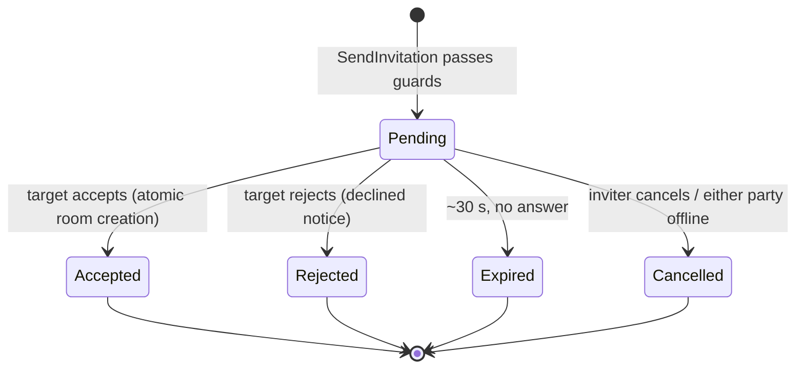
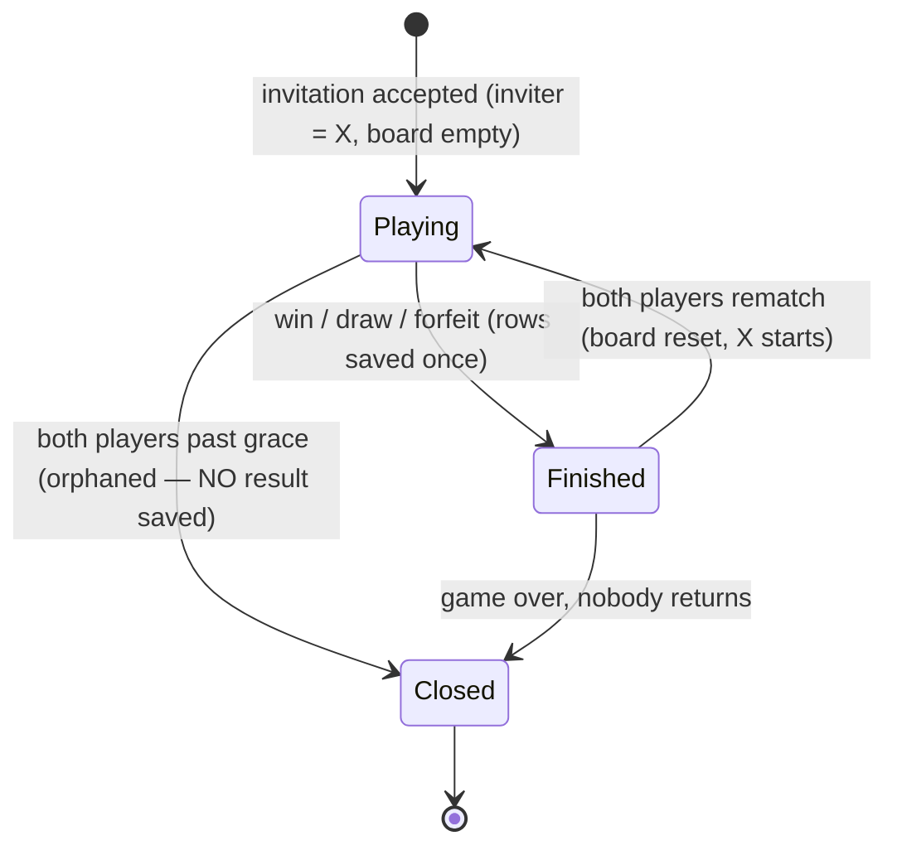
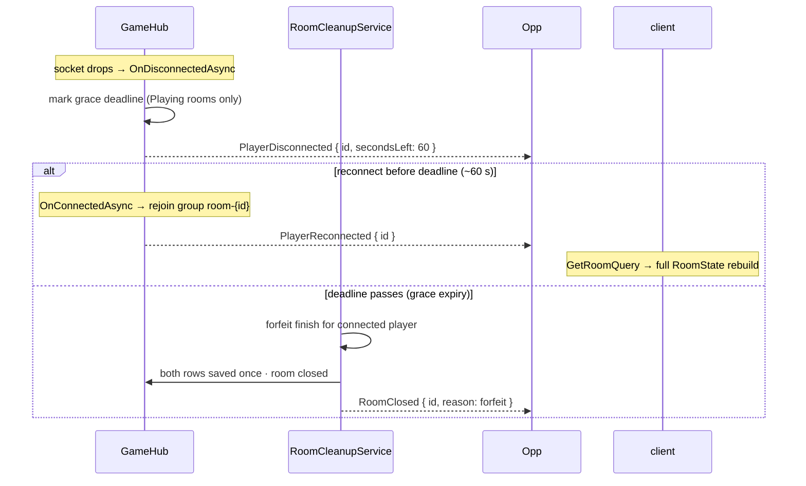

# Room & Invitation Lifecycle

*The life story of rooms and invitations — creation, play, disconnection, expiry, forfeit and cleanup — with the exact timers and rules.*

Parent document: [PRD](../00-product/PRD.md) §4.3 · Related: [Real-time & SignalR](../01-architecture/realtime-signalr.md) · [ADR-0005](../01-architecture/adr/0005-in-memory-room-store.md) · [ADR-0009](../01-architecture/adr/0009-invitations-replace-room-codes.md) · [ADR-0014](../01-architecture/adr/0014-in-memory-state-trio.md) · Decision record: [ADR-0013](../01-architecture/adr/0013-per-room-locking-no-optimistic-concurrency.md)

---

## 1. The state machines

### 1.1 Invitation

Invitation rules:

| Rule | Detail |
| --- | --- |
| One outgoing per player | A player with a pending outgoing invitation gets `Invite.AlreadyPending` (FR-33) |
| Lifetime | ~30 s from creation, measured on the injected `TimeProvider` (fake-time testable) |
| Rejection cooldown | After a decline, re-inviting the same player is blocked ~30 s (`Invite.Cooldown`) |
| Offline immediately | A party going offline cancels the invitation with the offline notice — no extra grace (FR-35) |
| Terminal states are monotonic | Accepted/Rejected/Expired/Cancelled never change again; a late accept on a terminal invitation fails cleanly |

### 1.2 Room

Room rules:

| Rule | Detail |
| --- | --- |
| Created only by accepted invitation | No speculative/idle rooms exist; no idle-room expiry (FR-30, ADR-0009) |
| At most one active game per player | `Room.AlreadyActive` guards double-booking (FR-30) |
| Finished is immutable | Result set exactly once; further moves get `Game.AlreadyOver` (E5) |
| Orphaned rooms close **without saving** | Both players gone past grace → close, no `Match` rows (FR-30) |
| Rematch resets in place | Same room, board cleared, X to start; needs both-ready flags (else `Game.AlreadyOver`) |

## 2. Timers & config (`RoomSettings`)

| Timer | Default | What fires |
| --- | --- | --- |
| `GraceSeconds` | **60** | Disconnected player forfeits → opponent wins, rows saved once (FR-29) |
| `InvitationTtlSeconds` | **30** | Pending invitation expires (`InvitationExpired` notice) |
| `CooldownSeconds` | **30** | Rejection cooldown lifts |
| `CleanupIntervalSeconds` | **5** | The `RoomCleanupService` tick (forfeits, orphan closes, invitation expiry) |

All timers read from the injected `RoomSettings` options — changing a timing is a config edit, never a code change ([settings-and-configuration.md](settings-and-configuration.md)).

## 3. Who does what (ownership)

| Concern | Owner |
| --- | --- |
| Room state + per-room locks | `InMemoryRoomStore` (`IRoomStore`) |
| Presence (`userId → connectionCount`) | `PresenceTracker` (`IPresenceTracker`) — increments on connect, decrements on disconnect; 0 = offline immediately |
| Invitation guards, TTL, cooldown, atomic accept | `InvitationManager` (`IInvitationManager`) |
| Timeout sweeps | `RoomCleanupService` (Hosted `BackgroundService`, 5 s tick; one try/catch per iteration so one bad entity never stalls the loop) |
| Domain models | `Domain/Online/` (`Room`, `RoomStatus`, `RoomPlayer`, `Invitation`) — pure, no locks, no I/O, no SignalR |

Container discipline: the three singletons never reference each other; commands orchestrate cross-container flows ([ADR-0014](../01-architecture/adr/0014-in-memory-state-trio.md)).

## 4. Disconnect & forfeit flow

Full client contract: [realtime-signalr.md](../01-architecture/realtime-signalr.md) §7.

## 5. Lock order (deadlock-free by construction)

Cross-container work exists in exactly one place — **accept**: invitation lock acquired **first**, room lock **second**. No other cross-container sequence exists in v1; adding one requires amending this file + [ADR-0014](../01-architecture/adr/0014-in-memory-state-trio.md).

## 6. Client-visible landing (what the lobby must show)

Backend states map 1:1 to lobby UI on **every page** (hub is site-wide, popup in `_Layout`):

| Terminal state | Inviter (sender) sees | Target (invitee) sees | Rule |
| --- | --- | --- | --- |
| `Accepted` (room created, inviter = X) | Waiting card **hides** → green `room-status` banner: “Room {id}… ready — you are X. Online play continues next (M11).” + success toast | Popup hides → same green banner: “you are O…” + success toast | Room id is from the `RoomState` payload (first 8 chars, display only) |
| `Rejected` (decline) | Waiting card **hides** → red `invite-status` banner: “{name} declined your invitation. You can invite again after 30s cooldown.” + toast | Popup hides → red banner: “You declined the invitation.” + toast | Cooldown message is always shown (server enforces 30 s) |
| `Cancelled` (inviter cancel / either party offline) | Waiting card **hides** → red banner: “Invitation cancelled.” / “The other player went offline. Invitation cancelled.” + toast | Popup hides (if open) → same red banner + toast | Offline cancel is immediate, no grace (FR-35) |
| `Expired` (~30 s, no answer) | Waiting card **hides** → red banner: “Invitation expired.” + toast (target auto-rejects on timeout) | N/A (popup already closed on timeout) | Target auto-sends `RespondToInvitation(false)` on 30 s countdown end |

Other client rules (M10):

- Waiting card shows **immediately** on `InvitePlayer` success — sender never waits for the toast (FR-33 visual).
- `Invite` buttons for the pending target show `Waiting…` disabled; all buttons reset when the Waiting card hides.
- Invitations are delivered **only to the two participants** (per-user `Clients.User`), never `All` — bystanders see nothing.
- Room page (`/Rooms/{id}`) navigation on accept arrives in **M11**; until then the green banner is the correct M10 landing (no dead end, no stuck Waiting).

## Assumptions

- Grace (60 s) applies only to `Playing` rooms — invitations and finished rooms follow their own timers.
- Restart wipes presence + invitations + active rooms; finished `Match`es persist in SQL ([ADR-0005](../01-architecture/adr/0005-in-memory-room-store.md)).
- Presence is hub-connection counted; multiple tabs per user are supported (count > 1 stays online).
- The `Waiting` room era is over: status is `Playing/Finished/Closed` only — any doc saying `Waiting` is stale.
