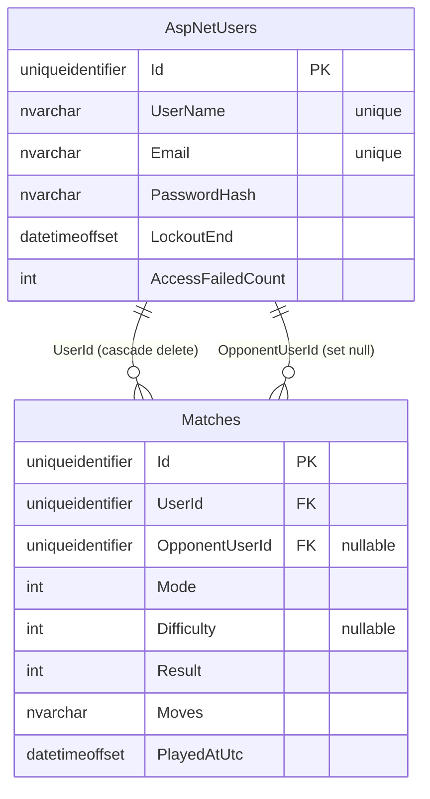

# Schema & ERD

*Every table, column, key, index and relationship — and what deliberately does **not** live in the database (rooms, invitations, presence).*

Parent document: [PRD](../00-product/PRD.md) · Related: [System architecture](../01-architecture/system-architecture.md) · [ADR-0013](../01-architecture/adr/0013-per-room-locking-no-optimistic-concurrency.md) · [Concurrency](concurrency.md) · [Migrations & Indexes](migrations-and-indexes.md)

---

## 1. The two table families

| Family | Tables | Owner |
| --- | --- | --- |
| **Identity** (framework-owned) | `AspNetUsers`, `AspNetRoles`, `AspNetUserRoles`, `AspNetUserClaims`, `AspNetUserLogins`, `AspNetUserTokens` | Created/managed by ASP.NET Core Identity — **never designed by hand**; only our `ApplicationUser` fields are visible |
| **Game records** (ours) | `Matches` | The only application table we design |

## 2. `AspNetUsers` (ApplicationUser)

`IdentityUser<Guid>` — key fields the app depends on:

| Column | Type | Notes |
| --- | --- | --- |
| `Id` | `uniqueidentifier` | PK — the identity every command uses (`ICurrentUser`) |
| `UserName` / `NormalizedUserName` | `nvarchar(max)` | **UNIQUE** index (Identity) — "username taken" error |
| `Email` / `NormalizedEmail` | `nvarchar(max)` | **UNIQUE** index — "email taken" error (registered users only) |
| `PasswordHash` | `nvarchar(max)` | Identity-hashed; never read back by app code |
| `LockoutEnd` / `LockoutEnabled` / `AccessFailedCount` | `datetimeoffset`/bit/int | Lockout state (5 failed attempts → 5 min) |
| `SecurityStamp` / `ConcurrencyStamp` | `nvarchar` | Identity internals (session invalidation, EF concurrency) |

## 3. `Matches` (our table)

One row per player per finished game — written **once**, never updated (FR-26, [concurrency.md](concurrency.md)):

| Column | Type | Notes |
| --- | --- | --- |
| `Id` | `uniqueidentifier` | PK |
| `UserId` | `uniqueidentifier` | FK → `AspNetUsers(Id)`, **CASCADE delete** (account deletion removes your rows) |
| `OpponentUserId` | `uniqueidentifier` NULL | FK → `AspNetUsers(Id)`, **SET NULL on delete** — deleting your account must never erase your opponent's history |
| `Mode` | `int` | `0` Local · `1` Computer · `2` Online (enum stored as int) |
| `Difficulty` | `int` NULL | `0` Easy · `1` Medium · `2` Hard; NULL unless Mode = Computer |
| `Result` | `int` | From **this player's view**: `0` Win · `1` Loss · `2` Draw (stats = counts of `Result` per `UserId`) |
| `Moves` | `nvarchar(max)` | Comma-separated cell indices in play order, e.g. `"4,0,1,8"` — the single source of truth for cell occupancy; **replayed by the engine** for the forgery check (`SaveMatchCommand`, `Game.ForgedResult`) |
| `PlayedAtUtc` | `datetimeoffset` | UTC always (via injected `TimeProvider`, never local time) |

**Constraints & indexes:**

| Constraint | Effect |
| --- | --- |
| `UNIQUE (NormalizedUserName)`, `UNIQUE (NormalizedEmail)` | Enforced by Identity — the `Auth.Duplicate*` errors |
| `INDEX (UserId, PlayedAtUtc DESC)` | History + stats queries read one user's recent matches in order |
| FK `UserId` cascade, FK `OpponentUserId` set-null | Account deletion: your rows go, your opponent's row keeps its history with the opponent reference nulled |

## 4. ERD

## 5. What deliberately does NOT live in the database

| State | Where it lives | Why not SQL |
| --- | --- | --- |
| Rooms, room players, grace deadlines | `InMemoryRoomStore` (singletons) | Changes every move; ~200 B/room; a restart legitimately ends them ([ADR-0005](../01-architecture/adr/0005-in-memory-room-store.md)) |
| Presence (`userId → connectionCount`) | `PresenceTracker` | Flips per connect/disconnect |
| Invitations, TTL, cooldown | `InvitationManager` | ~30 s lifetime; never worth a write round-trip |

This is the deliberate inversion of the seniors' shape (games + moves as DB tables): **finished results persist; live state never does.**

## Assumptions

- `ApplicationUser` has no custom columns beyond `IdentityUser` — adding one (e.g. a display name) is a schema change through migrations, not a hand edit.
- The `Moves` string format (comma-separated ints) is a contract: engine replay, history rendering and the forgery check all read it; changing it requires a data migration, not just code.
- Enum values are stored as ints and are v1-stable; adding a value is fine, renumbering an existing one is never allowed.
- Identity tables are framework-owned — backup and retention questions for them are the host's concern, not the app's.
