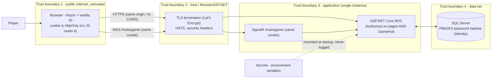

# Security

*The threat model and the complete security control set for the Tic Tac Toe MVP — concrete, testable measures, with OWASP mapping, accepted risks and a pre-release checklist.*

Controls are stated so each one is verifiable — by the unit suite ([test-strategy.md](test-strategy.md)), by configuration review, or by the pre-release checklist in §8.

---

## 1. Scope and Assets

| Asset | Why it matters |
| --- | --- |
| User credentials (password hashes) | Account takeover → identity spoofing (PBKDF2 hashes in SQL Server) |
| Session cookie (Identity) | **The** bearer of identity — single auth mechanism for pages *and* hub |
| Game state (moves, results) | Integrity of play; server-authoritative by design |
| PII: username, email, login IPs | Privacy obligations; enumerated in §3.11 |
| Availability of app, hub and DB | DoS resistance for rooms and invitations |

Out of scope: client-device compromise beyond XSS (malware, extensions), physical security, and multi-instance deployment hardening (single-node MVP).

## 2. Threat Model

### 2.1 Data flow and trust boundaries

Boundary rules: nothing outside T2 speaks plaintext or reaches the database; the client (T1) is untrusted — every value it sends is re-validated server-side; secrets cross no boundary at runtime (injected at process start).

### 2.2 STRIDE analysis

| # | Category | Threat | Vector | Affected component | Mitigation |
| --- | --- | --- | --- | --- | --- |
| S1 | Spoofing | Session-cookie theft via XSS | Malicious script reads non-HttpOnly cookie | App | Cookie is **`HttpOnly`** — JavaScript cannot read it (the structural fix the cookie design gives over token-in-storage designs) |
| S2 | Spoofing | Credential stuffing / brute force | Automated login attempts | Login | Lockout 5 attempts / 5 min (§3.1); PBKDF2 hashing |
| T1 | Tampering | Illegal or crafted moves from a modified client | Custom client bypassing the UI | Moves (hub/JSON) | Server-authoritative engine guards: participant + turn + bounds + occupancy + status (§3.7) |
| T2 | Tampering | SQL injection | Crafted username/email/position fields | App, SQL Server | EF Core parameterized queries only; validator allowlists (§3.6) |
| T3 | Tampering | Double-move race | Two move requests simultaneously | Room store | Per-room lock (ADR-0013) + re-validation inside the lock; loser gets `Game.NotYourTurn`/`CellOccupied` |
| R1 | Repudiation | Player denies making moves | No attribution | Matches table | Every saved match row records `<|close|>UserId`, `PlayedAtUtc`; server logs correlate by user id |
| I1 | Information disclosure | IDOR — joining someone else's room | Guessed room ids | Rooms | Rooms created only via invitation (internal opaque ids); non-participant reads get 404 (§3.7) |
| I2 | Information disclosure | Secrets or PII in logs | Verbose request logging | Serilog | Never log passwords, cookies, full emails (§3.11) |
| I3 | Information disclosure | User enumeration | Register/login error differences | Register/login | Login returns an identical generic error for unknown user vs wrong password (§3.7) |
| D1 | DoS | Login flood | Burst requests | Login | Lockout throttles targeted accounts; MonsterASP.NET host rate limits apply |
| D2 | DoS | Move spam | Automation clicking constantly | Moves | Moves fail fast server-side (`Game.NotYourTurn`) — spam costs the attacker nothing to block; no row is written |
| D3 | DoS | Hub connection exhaustion | Many concurrent connections | SignalR hub | Presence is per-user counted; Freerazor-level load is trivial; connection caps are a host-plan concern |
| D4 | DoS | Stale rooms accumulate | Abandoned rooms | Memory | `RoomCleanupService` sweeps orphans every 5 s |
| E1 | Elevation of privilege | Non-participant joins a room group | Crafted hub invocation | GameHub | Server-side participant validation before `Groups.AddToGroupAsync`; clients never name groups ([ADR-0003](../01-architecture/adr/0003-signalr-hub-as-command-gateway.md)) |
| E2 | Elevation of privilege | Acting on another player's game | IDOR on commands | Command handlers | Every command resolves identity from `ICurrentUser` and checks room participation (§3.7) |

## 3. Security Controls

### 3.1 Identity and passwords

| Control | Specification |
| --- | --- |
| Password hashing | ASP.NET Core Identity `PasswordHasher` — PBKDF2 (HMAC-SHA-256), framework-default iteration count (≥ 100 000), per-password salt |
| Password policy | Minimum 8 characters, at least one upper-case, one lower-case, one digit |
| Uniqueness | Username unique (3–20 chars, `^[A-Za-z0-9_]+$`), email unique and valid, max 256 chars |
| Lockout | 5 failed attempts → locked 5 minutes (`LockoutEnabled`, `MaxFailedAccessAttempts = 5`, `LockoutTimeSpan = 5 min`); locked logins show `Auth.LockedOut` |
| Passwords in transit | Only over HTTPS bodies; never in URLs, never logged |

### 3.2 Session and logout

| Control | Specification |
| --- | --- |
| Session | Identity cookie `IdentityConstants.ApplicationScheme`: 14 days, sliding expiration; user activity refreshes it |
| Cookie flags | `HttpOnly` always; `Secure` in Production (TLS terminates at the host); `SameSite=Lax`; path `/` |
| Logout | `POST /Account/Logout` signs out (cookie cleared) and stops the hub connection; Razor anti-forgery token required |
| Post-logout | The cleared cookie is the whole revocation story — there are no bearer tokens to survive it |
| Multi-device | Allowed simultaneously; each device has its own session cookie |

### 3.3 Transport security

| Control | Specification |
| --- | --- |
| HTTPS only | All public traffic via the host's TLS termination; HTTP redirects to HTTPS |
| HSTS | `Strict-Transport-Security: max-age=31536000; includeSubDomains` on HTTPS responses |
| TLS version | Minimum TLS 1.2, TLS 1.3 preferred (host defaults) |
| Internal traffic | Single-host deploy — no untrusted listener inside; TLS re-encryption is a scale-out concern, out of MVP scope |
| Forwarded headers | TRUSTED only via the host's `ForwardedHeaders` configuration; client IPs used for lockout/audit are correct |

### 3.4 CORS

**Not applicable — by design.** Browser, pages and hub are same-origin. There is no CORS policy to allowlist and no credential-header surface. Adding any cross-origin API later is a decision that rewrites this section.

### 3.5 Input validation and output encoding

| Control | Specification |
| --- | --- |
| Command validation | `IValidator<T>` run as the first handler statement (in-handler, [cqrs-and-mediator](../01-architecture/cqrs-and-mediator.md) §3.2); failures → `Validation.Error` inline |
| FR-01 rules | Username `^[A-Za-z0-9_]{3,20}$`; email valid, ≤ 256; password min 8 with upper/lower/digit |
| Game input | `position` integer 0–8 (reject `Game.InvalidCell`); `roomId` from server-parsed route, never from a client-chosen claim |
| SQL injection | EF Core parameterized queries exclusively; no raw SQL anywhere in `Application`/`Infrastructure` |
| XSS | Razor default HTML encoding (`@`) on all user data; no `Html.Raw` of user input; usernames render as text |
| Anti-forgery | Razor `ValidateAntiForgeryToken` on every POST form (token in body, `[ValidateAntiForgeryToken]` on actions) |
| Defense in depth | The Domain engine re-validates every rule (turn, bounds, occupancy, status) even for requests that pass validators — clients are untrusted |

### 3.6 Authorization and anti-IDOR

| Surface | Rule |
| --- | --- |
| Default posture | Every controller action and hub method `[Authorize]` except `/Account/Login`, `/Account/Register`, `/Account/AccessDenied`, `/Error` |
| Game commands | `MakeOnlineMove`, `LeaveRoom`, `RequestRematch`, `GetRoom` resolve the room and check `ICurrentUser` against the two participants → `Room.NotParticipant` otherwise |
| Invitation commands | `RespondToInvitation` requires the caller to be the invitation's target; `CancelInvitation` requires the inviter (`Invite.Forbidden` otherwise) |
| Reads | `GetHistory`/`GetStats` return only the caller's own rows; room detail returns 404 to non-participants (avoids disclosing existence) |
| Identity binding | User identity comes exclusively from the validated cookie claims (`ICurrentUser`) — never from request bodies or query strings |
| Hub groups | Group names `room-{id}` are computed server-side from validated room membership; clients never supply group names |
| Broadcasts | `room-{id}` broadcasts contain board state and usernames only — never emails, cookies, or IPs |

### 3.7 Abuse and denial-of-service controls

| Policy | Trigger | Control |
| --- | --- | --- |
| Login flood | Automated attempts | Identity lockout (5 / 5 min) throttles targeted accounts |
| Move spam | Click automation | Failing moves cost a validation read; no write occurs (`Game.NotYourTurn`) |
| Hub connections | Many concurrent connections | Free plan handles the budget target (≥ 200 concurrent authenticated, [realtime-signalr](../01-architecture/realtime-signalr.md) §8); presence counting is per user |
| Request body | Global | Razor model binding defaults; JSON endpoint body limit is the framework default (payloads are tiny) |
| Stale resources | Background | `RoomCleanupService` sweeps orphaned rooms + stale invitations every 5 s |

### 3.8 Security headers

Applied by middleware to every response (and by the host for TLS):

| Header | Value |
| --- | --- |
| `Content-Security-Policy` | `default-src 'self'; script-src 'self'; style-src 'self' 'unsafe-inline'; img-src 'self' data:; font-src 'self'; connect-src 'self'; object-src 'none'; base-uri 'self'; form-action 'self'; frame-ancestors 'none'` |
| `X-Content-Type-Options` | `nosniff` |
| `X-Frame-Options` | `DENY` (with CSP `frame-ancestors 'none'`) |
| `Referrer-Policy` | `strict-origin-when-cross-origin` |
| `Permissions-Policy` | `camera=(), microphone=(), geolocation=()` |
| `Strict-Transport-Security` | `max-age=31536000; includeSubDomains` (HTTPS responses only) |

CSP note: `script-src 'self'` is feasible because all JavaScript lives in `wwwroot/js/` files (no inline scripts); `style-src 'unsafe-inline'` is required for Bootstrap's dynamic styles.

### 3.9 Secrets management

| Control | Specification |
| --- | --- |
| Sources | Environment variables in production; user-secrets in development; **never** committed `appsettings.json` values |
| Secrets list | `ConnectionStrings__DefaultConnection` (DB password) — the *only* production secret in v1 (no signing keys in cookie auth) |
| Least privilege | DB user owns only the application schema; no superuser on the free plan |
| Rotation | DB password: rotate during a maintenance window (single node restart) |

### 3.10 Privacy and logging

| Control | Specification |
| --- | --- |
| Never logged | Passwords (any field), cookies, connection strings, full emails, Authorization headers |
| Email masking | Logs show at most `j***@example.com` when an identifier must appear |
| Correlation | A correlation id per request, propagated to logs and outgoing hub metadata — used instead of logging sensitive identifiers |
| What is logged | Handler name, outcome, duration, correlation id, masked identifiers ([system-architecture](../01-architecture/system-architecture.md) §5.1) |
| Retention | Rolling-file logs capped by Serilog sink configuration; no PII in retained files |

## 4. SignalR-Specific Security

| Concern | Control |
| --- | --- |
| Authentication | Hub is `[Authorize]`; the **same Identity cookie** authorizes the negotiate — no `access_token` query string is needed (cookie auth does not cross domains in v1) |
| Group integrity | Server-side participant validation before `Groups.AddToGroupAsync` (§3.6); the server computes group names — clients never supply them |
| Message hygiene | Default `MaxIncomingMessageSize` kept (32 KB); client→server invokes are the §2 catalog only — no arbitrary data is relayed to other clients |
| Broadcast payloads | `RoomState` payloads contain board state and usernames only — never emails, cookies, or IPs |
| Presence | In-memory per-user connection counts; presence data (username, count) is non-sensitive; multiple tabs count as one user |
| Connection abuse | Per-user connection counting bounds the surface; keep-alive ping and server timeout disconnect dead connections |

## 5. Dependency Hygiene

| Control | Specification |
| --- | --- |
| Package pinning | `Directory.Packages.props` (Central Package Management) — every version pinned; **no floating ranges** ([ADR-0012](../01-architecture/adr/0012-pinned-stable-stack.md)) |
| Review gate | Any new package is an ADR-worthy decision — never an opportunistic `dotnet add package` |
| License rule | Bump stops if a license moves away from MIT-family until reviewed |

## 6. OWASP Top 10 (2021) Mapping

| Risk | How this project addresses it |
| --- | --- |
| A01 Broken Access Control | `[Authorize]` everywhere except auth endpoints; participant checks on every room/invitation command and read (404/403); server-side hub group validation; identity only from cookie claims (§3.6) |
| A02 Cryptographic Failures | PBKDF2 password hashing; HttpOnly cookies; HTTPS + HSTS + TLS 1.2+ (§3.1–§3.3) |
| A03 Injection | EF Core parameterization; validator allowlists per command; Razor default output encoding; no raw SQL (§3.5) |
| A04 Insecure Design | Server-authoritative engine rules; lock-based race safety; lockout on login (§3.1, §3.6) |
| A05 Security Misconfiguration | Same-origin only (no CORS surface); security headers middleware; environment-specific config; secrets out of the repo (§3.4, §3.8, §3.9) |
| A06 Vulnerable and Outdated Components | Central pinning; ADR-gated package adds (§5) |
| A07 Identification and Authentication Failures | Identity lockout 5/5 min; generic login errors; strong password policy; HttpOnly session cookie (§3.1, §3.2) |
| A08 Software and Data Integrity Failures | Cookie scheme only (no token crypto to break); server-side game-state transitions only |
| A09 Logging and Monitoring Failures | Structured Serilog logs with correlation IDs; redaction policy prevents the logs themselves becoming a leak (§3.10) |
| A10 SSRF | No endpoint fetches user-supplied URLs; the app performs no outbound HTTP calls in MVP — attack surface absent by design |

## 7. Accepted Risks and Roadmap

| Risk | Exposure | Mitigation now | Roadmap |
| --- | --- | --- | --- |
| In-memory presence (and hub groups) | Multiple app instances would split presence and broadcasts — silent misses, not corruption | Single-node MVP constraint (≥ 200 concurrent on one node); documented deployment boundary | Redis backplane + shared presence store before any scale-out |
| Registration errors reveal existing username/email | Account enumeration by scripted registration | Login errors stay generic; lockout throttles scripted guessing | Acceptable for MVP; verify-email flow post-MVP |
| No email verification / no password reset | Accounts can register addresses they do not own | Nothing else depends on email ownership in v1 | Email verification + reset flow post-MVP |

## 8. Pre-Release Security Checklist

Run at every release; every item must pass:

| # | Check | Verification |
| --- | --- | --- |
| 1 | Only `/Account/Login`, `/Account/Register`, `/Account/AccessDenied`, `/Error` are anonymous | Manual sweep of controller actions + unauthorized-request walkthrough (test-plan §walkthrough) |
| 2 | Lockout: 5 failed logins → locked message for 5 min | Manual walkthrough (login x5 wrong) |
| 3 | Cookie flags: `HttpOnly`, `Secure` (prod), `Lax` | Browser DevTools cookie inspection on production deploy |
| 4 | Security headers on all responses (CSP, nosniff, DENY, Referrer-Policy, Permissions-Policy, HSTS) | `curl -I` checklist against production |
| 5 | HTTPS enforced; HTTP redirects; no mixed content | Browser devtools + redirect check |
| 6 | IDOR: a third user gets 404 on another pair's `/Rooms/{id}`; `Room.NotParticipant` on moves | Manual two-browser walkthrough |
| 7 | Hub rejects non-participant group adds (cannot name groups) | Manual hub-invoke walkthrough |
| 8 | No secrets in repository; `appsettings.json` has placeholder connection string only | Grep the repo + read the committed appsettings |
| 9 | No passwords/tokens/full emails in logs | Grep production logs after login + hub session |
| 10 | Test-only values (RoomSettings timings, test connection string) absent from production appsettings | Config diff before deploy ([settings-and-configuration](../02-backend/settings-and-configuration.md)) |

## Assumptions

- TLS is terminated at the host (Let's Encrypt); traffic inside the single-node deploy is plaintext and private — the documented MVP boundary.
- The CSP `style-src 'unsafe-inline'` exists because Bootstrap injects styles at runtime; scripts stay strictly `'self'` (no inline scripts in views — all JS lives in `wwwroot/js/`).
- The 14-day sliding cookie lifetime and lockout (5/5 min) are Identity defaults — changing them is an ADR + config edit, recorded in `settings-and-configuration.md`.
- Single instance by construction: presence, rooms and invitations are in memory; multi-instance deployment is explicitly out of scope until Redis lands.
