# AGENTS.md — Operating Manual for This Repository

*The operating manual for any coding agent — human or AI — contributing code, tests, or documentation to Tic Tac Toe; read it in full before touching anything.*

## Purpose & How to Use This File

This file converts the PRD and the docs tree into a safe, repeatable workflow:

1. Read the [PRD](../00-product/PRD.md) first — it is the product source of truth and wins over every other document, including this one. The first build's boundary is the [V1 scope](../00-product/v1-scope.md): the full game (offline, computer, online invitations), nothing more.
2. Read this manual, especially the [Golden Rules](#golden-rules) and the [Build Order (M0 → M13)](#build-order-m0--m13).
3. Locate your milestone in the build order, re-read the docs listed for it, then implement.
4. If you own a discipline (product, architecture, database, UI/UX, frontend, QA/security, DevOps), also load your role prompt from [prompts/](prompts/).
5. Before every commit and PR: run **Verify all** from the [Commands Cheat Sheet](#commands-cheat-sheet) and walk the [Working Agreements](#working-agreements).

If this file and the PRD disagree, the PRD wins and this file gets corrected.

## Project Overview

Tic Tac Toe is a turn-based board game with three modes: solo vs computer (Easy/Medium/Hard AI), local pass-and-play, and online multiplayer via **invitations** — the lobby lists who is online (site-wide presence, [ADR-0009](../01-architecture/adr/0009-invitations-replace-room-codes.md)); an Available player is invited, accepts, and a room is created atomically with the inviter as X. The backend is .NET 10 / ASP.NET Core MVC (Clean Architecture + DDD + CQRS via Cortex.Mediator) on SQL Server (Express locally) via EF Core, with SignalR rooms and Serilog logging. The frontend is Razor Views + vanilla JS ES modules styled with Bootstrap 5.3 in `wwwroot/`. Auth is Identity **cookies** (no JWT). Everything is deployed manually by the owner to MonsterASP.NET. There is no Docker, no SPA, no npm build. The complete product definition — vision, scope, user stories, requirements, delivery plan — lives in the [PRD](../00-product/PRD.md).

## Golden Rules

1. **The PRD is the source of truth.** If code and docs disagree, fix the code to match the PRD — or, if the PRD itself must change, record the decision in a new ADR in [01-architecture/adr/](../01-architecture/adr/) and update the PRD. Never drift silently.
2. **Respect the dependency rule:** Domain ← Application ← Infrastructure ← Web. `TicTacToe.Domain` references nothing; `TicTacToe.Application` references only Domain; `TicTacToe.Infrastructure` implements Application abstractions; `TicTacToe.Web` does DI composition and transport only. See [clean architecture & DDD](../01-architecture/clean-architecture-ddd.md).
3. **Controllers and the hub are thin.** Send a Cortex.Mediator command/query, map `OperationResult<T>` to page/JSON/hub — no business or orchestration logic in controllers or `GameHub`.
4. **No business logic outside handlers and the engine.** Board rules live **only** in `Domain/Engine` (`Rules`, `Board`) — never in controllers, the hub, or JavaScript. Handlers orchestrate, they never decide ([ADR-0006](../01-architecture/adr/0006-pure-game-engine-in-domain.md)).
5. **All backend tests live in one project** — `test/TicTacToe.Application.UnitTests`, NUnit + Moq + Shouldly + AutoMock, mirroring the `Features/` layout ([ADR-0015](../01-architecture/adr/0015-vertical-slices-and-unit-only-tests.md)). **There are no other test suites** — no integration suite, no E2E/Playwright.
6. **Every command/query has a handler in its own slice** under `Features/{Area}/{Feature}/Command|Query/` ([ADR-0015](../01-architecture/adr/0015-vertical-slices-and-unit-only-tests.md)). Validation is **explicit, in the handler** — never a pipeline behavior.
7. **Queries never load rooms or aggregates.** The read side projects from the `Matches` table straight to DTOs ([cqrs-and-mediator](../01-architecture/cqrs-and-mediator.md)).
8. **Expected failures are `OperationResult<T>`, not exceptions** ([ADR-0010](../01-architecture/adr/0010-result-pattern-expected-failures.md)): not your turn, cell occupied, full invitation, cooldown.
9. **Concurrency is locks, not retries.** Per-room / per-invitation / per-user locks in memory ([ADR-0013](../01-architecture/adr/0013-per-room-locking-no-optimistic-concurrency.md)); `Matches` rows are insert-once; handlers never contain retry loops.
10. **The SignalR hub is a command gateway** ([ADR-0003](../01-architecture/adr/0003-signalr-hub-as-command-gateway.md)): it authenticates, dispatches `IMediator`, and broadcasts — presence tracking is the only exception. The hub never mutates game state directly.
11. **Broadcast AFTER the lock is released, never inside it.** The handler returns the authoritative `RoomState`; the same payload is broadcast ([clean-architecture-ddd](../01-architecture/clean-architecture-ddd.md) §7).
12. **Database naming via EF defaults** (`PascalCase` properties → EF-mapped `nvarchar`/`datetimeoffset` columns with `_utc` timestamp suffixes); never hand-name tables with raw SQL.
13. **No secrets in code, config, or docs.** The connection string comes from user-secrets/environment variables; never log passwords, tokens, or full emails.
14. **Adding a cross-cutting decision? Write a new ADR** in [01-architecture/adr/](../01-architecture/adr/) following the existing numbering and format, and link it from the affected docs.

## Conventions Quick Reference

| Area | Rule | Authoritative doc |
| --- | --- | --- |
| C# naming | PascalCase types, methods, properties; camelCase locals and parameters; `_camelCase` private fields; `I`-prefixed interfaces; async methods end with `Async`; file-scoped namespaces; nullable reference types on. | [system-architecture](../01-architecture/system-architecture.md) §5.5 |
| C# file placement | Domain: `Engine/` (+ `Engine/Ai/`), `Online/`, `Entities/`, `DTOs/`. Application: `Features/{Area}/{Feature}/Command|Query/`, `Contracts/`, `Mapping/`, `Settings/`. Infrastructure: `Data/`, `Identity/`, `Services/`. Web: `Controllers/`, `Hubs/`, `Middleware/`, `Program.cs`. | [clean-architecture-ddd](../01-architecture/clean-architecture-ddd.md) §3 |
| CQRS folders | `Features/{Area}/{Feature}/Command/` = `XxxCommand.cs` + `XxxCommandHandler.cs`; `…/Query/` = `GetXxxQuery.cs` + `GetXxxQueryHandler.cs` | [cqrs-and-mediator](../01-architecture/cqrs-and-mediator.md) |
| DI | Constructor injection only; `Program.cs` is the only composition point (`AddApplication()` + `AddInfrastructure()`); lifetimes per §2.1 table; `ValidateScopes` in Development. | [clean-architecture-ddd](../01-architecture/clean-architecture-ddd.md) §2.1 |
| Tests | NUnit + Moq + Shouldly + AutoMock; ONE project: `test/TicTacToe.Application.UnitTests` mirroring `Features/`; `MethodName_Scenario_ExpectedResult`; AAA | [test-strategy](../05-quality/test-strategy.md) |
| JavaScript | ES modules, kebab-case file names (`room.js`, `lobby.js`); one module, one job; **render-only**: `RoomState` replaces local state, never merges; ≤ ~15 KB per module | [frontend-architecture](../04-frontend/frontend-architecture.md) |
| Styling | Bootstrap 5.3 + CSS variables (`--ttt-*`) in `wwwroot/css/site.css`; no colors typed outside tokens; no Tailwind | [ux-ui-design-system](../04-frontend/ux-ui-design-system.md) |
| Database | EF Core code-first; `Matches` insert-once; `UserId` cascade, `OpponentUserId` set-null; UTC timestamps (`_utc` suffix); no raw SQL ever | [schema-and-erd](../03-database/schema-and-erd.md) |
| HTTP surface | Razor pages/actions; **one** JSON endpoint (`POST /api/game/move`); Razor POSTs re-render forms (HTTP statuses are JSON-only) | [cqrs-use-cases](../02-backend/cqrs-use-cases.md) |
| SignalR | Hub at `/hubs/game` (cookie auth); groups `room-{id}`; per-user events for presence/invitations; 13 events only | [realtime-signalr](../01-architecture/realtime-signalr.md) |

## Commands Cheat Sheet

| Task | Command | Run from |
| --- | --- | --- |
| Build solution | `dotnet build` | repo root |
| Run unit tests | `dotnet test` | repo root |
| Run the app | `dotnet run --project src/TicTacToe.Web` | repo root |
| Add an EF migration | `dotnet ef migrations add <Name> --project src/TicTacToe.Infrastructure --startup-project src/TicTacToe.Web` | repo root |
| Apply migrations (Development) | `dotnet ef database update --project src/TicTacToe.Infrastructure --startup-project src/TicTacToe.Web` | repo root |
| Verify all | `dotnet build && dotnet test && dotnet ef database update --project src/TicTacToe.Infrastructure --startup-project src/TicTacToe.Web` | repo root |

No npm, no Docker, no bundler — `wwwroot/` is deployed verbatim. Verify all is the gate for every PR.

## Build Order (M0 → M13)

Milestones run in order — **one feature per milestone**, the owner checks it before the next opens. There are no time estimates — order and dependencies drive delivery. **Every milestone is one feature** with its own sign-off: the owner clicks it in the browser, tests are green, and only then does the next one open. **For the first build, implement only the V1 scope** ([v1-scope](../00-product/v1-scope.md)) — everything else is out of scope (not parked in a V2 list).

```mermaid
flowchart LR
    M0["M0 Spike"] --> M1["M1 Engine"]
    M1 --> M2["M2 AI"]
    M2 --> M3["M3 Local"]
    M3 --> M4["M4 Computer"]
    M4 --> M5["M5 Save & forgery"]
    M5 --> M6["M6 History & stats"]
    M6 --> M7["M7 Accounts"]
    M7 --> M8["M8 Guests"]
    M8 --> M9["M9 Presence"]
    M9 --> M10["M10 Invitations"]
    M10 --> M11["M11 Rooms"]
    M11 --> M12["M12 Account extras"]
    M12 --> M13["M13 Sweep"]
```



| Milestone | Feature (check off each) | FRs | Done when |
| --- | --- | --- | --- |
| M0 Spike | Host WebSockets + solution + pins | — | `dotnet build` zero warnings · CI green · pins in `Directory.Packages.props` · WebSockets negotiated |
| M1 Engine | Board, Rules, Evaluate, E1–E6 | FR-02…FR-05 | All 8 win lines × both symbols, draws, illegal moves, alternation · engine 100% line coverage · architecture test proves Domain has zero deps |
| M2 AI | Easy → Medium → Hard | FR-09, FR-10 | Hard never loses the exhaustive minimax sweep · Medium win/block tests · Easy seeded-random test · reply ≤ 500 ms |
| M3 Local | Pass-and-play | FR-01, FR-07, FR-11 | Pass-and-play works end-to-end · win highlighted · reset/new-match work · handler tests (unit) green |
| M4 Computer | vs computer UI + move API + difficulty | FR-08–FR-10 | Bot replies every move · difficulty switch works · W-11 passed |
| M5 Save & forgery | `SaveMatchCommand` + replay | FR-15 | Honest save writes row once · forged save rejected (`Game.ForgedResult`) · W-11 passed |
| M6 History & stats | History page + stats chips | FR-16, FR-17 | Totals from rows · paged history with opponent names · "Deleted player" shows correctly · U-9 green |
| M7 Accounts | Register / login / logout / lockout | FR-14 | Duplicate inline errors · generic credential error · lockout after 5 tries · W-8 passed |
| M8 Guests | Browser-only play, nothing stored | FR-18 | Guest plays local/computer · nothing hits the database · guest notice present |
| M9 Presence | Hub gateway + online list live | FR-32 | List updates live (no refresh) · counts flip on disconnect · walkthrough observed |
| M10 Invitations | Send, popup accept/reject, 30 s expiry, 30 s cooldown, one-outgoing | FR-33…FR-36 | Guard + race unit tests green · W-1, W-2, W-5, W-10 passed |
| M11 Rooms | Move, leave/forfeit, 60 s grace, rematch, cleanup | FR-25…FR-29, FR-31 | Both-rows-one-transaction test green · leave-forfeit test green · fake-time grace verified · W-3, W-4, W-6, W-7, W-9 passed |
| M12 Account extras | Change password, delete account | FR-19, FR-20 | Verify password required · delete in active room forfeits first then cascades · "Deleted player" correct · W-12 passed |
| M13 Sweep | Everything re-checked + deploy rehearsal | all | Full FR/US/copy/NFR sweep pass · tests green · ≤ 30 min deploy rehearsal clean |

> Each milestone's Goal/Backend/Frontend/Database/Verify detail lives in the roadmap's phase notes per milestone; the table above is the canonical milestone list — don't invent others. The sweep milestone (M13) is detailed in [roadmap](../00-product/roadmap.md) §3.

## Working Agreements

### Commit Messages

Conventional Commits, present-tense imperative summaries:

```
type(scope): imperative summary

Optional body explaining why.
Footer: Refs US-15 / Closes #12
```

- **Types:** `feat`, `fix`, `docs`, `test`, `refactor`, `perf`, `ci`, `build`, `chore`.
- **Scopes:** `auth`, `games`, `hub`, `lobby`, `room`, `client`, `db`, `docs`, `tests`.
- **Example:** `feat(rooms): atomic invitation accept with inviter as X (FR-34)`.

### PR Checklist

- [ ] **Verify all** passes end to end.
- [ ] New or changed behavior is covered by tests (NUnit unit suite; walkthrough scripts for real-server manifestations).
- [ ] No compiler or analyzer warnings introduced.
- [ ] New error codes appear in `error-handling.md` and the catalog tests.
- [ ] Docs updated wherever behavior or contracts changed; a new ADR written for cross-cutting decisions.
- [ ] UI changes follow the design tokens and AA contrast, are keyboard accessible, and announce state changes politely.
- [ ] No secrets, credentials, or PII in the diff or logs.
- [ ] The app still runs from `src/TicTacToe.Web` with no npm step.

### Definition of Done

Per [test-strategy](../05-quality/test-strategy.md): code reviewed; tests written and passing; no analyzer warnings; error catalog updated; accessibility checked for UI; works against SQL Server Express locally. Documentation changes are done when files are complete and specific (no placeholders), start with `# Title` + italic purpose, use relative links, and end with `## Assumptions`.

### Asking Questions & Recording Decisions

- **Product behavior question** → owned by the [product manager](prompts/product-manager.md); the answer lands in the PRD or [user-stories](../00-product/user-stories.md), never in a chat only.
- **Cross-cutting technical decision** → write a new ADR (next number, kebab-case title) in [01-architecture/adr/](../01-architecture/adr/) mirroring the existing format, link it from affected docs, then implement.
- **Local assumption** → record it in the artifact's `## Assumptions` section (docs) or the PR description (code).

## Where Things Live

| Doc | Description |
| --- | --- |
| [00-product/PRD.md](../00-product/PRD.md) | Canonical product source of truth: vision, scope, requirements, delivery plan. |
| [00-product/v1-scope.md](../00-product/v1-scope.md) | V1 scope: what the first build includes and defers. |
| [00-product/user-stories.md](../00-product/user-stories.md) | Acceptance criteria for US-01…US-17. |
| [00-product/roadmap.md](../00-product/roadmap.md) | M0–M13 delivery detail, dependencies, milestone acceptance (one feature per milestone). |
| [01-architecture/system-architecture.md](../01-architecture/system-architecture.md) | High-level system, stack, solution structure. |
| [01-architecture/clean-architecture-ddd.md](../01-architecture/clean-architecture-ddd.md) | Layers, dependency rule, domain model, ubiquitous language. |
| [01-architecture/cqrs-and-mediator.md](../01-architecture/cqrs-and-mediator.md) | Commands, queries, pipeline, Result pattern usage. |
| [01-architecture/adr/](../01-architecture/adr/) | ADRs 0001–0015 (clean arch → vertical slices + unit-only tests). |
| [02-backend/README.md](../02-backend/README.md) | Backend folder index. |
| [02-backend/cqrs-use-cases.md](../02-backend/cqrs-use-cases.md) | Full command/query catalog with guards, returns, errors. |
| [02-backend/error-handling.md](../02-backend/error-handling.md) | The exact error messages, status table, exception net. |
| [02-backend/room-invitation-lifecycle.md](../02-backend/room-invitation-lifecycle.md) | Room/invitation state machines, timers, cleanup, locks. |
| [02-backend/settings-and-configuration.md](../02-backend/settings-and-configuration.md) | appsettings + env overrides + cookie/secrets rules. |
| [03-database/schema-and-erd.md](../03-database/schema-and-erd.md) | Tables, ERD, constraints. |
| [03-database/migrations-and-indexes.md](../03-database/migrations-and-indexes.md) | Migration workflow and index catalog. |
| [03-database/concurrency.md](../03-database/concurrency.md) | Insert-once + per-room locks (no optimistic concurrency). |
| [04-frontend/ux-ui-design-system.md](../04-frontend/ux-ui-design-system.md) | Tokens, theme, component inventory, accessibility bar. |
| [04-frontend/pages-and-flows.md](../04-frontend/pages-and-flows.md) | Page specs, flows, responsive/a11y notes. |
| [04-frontend/frontend-architecture.md](../04-frontend/frontend-architecture.md) | JS module map, layering rules, hub ownership, design tech. |
| [04-frontend/animations.md](../04-frontend/animations.md) | Motion specs and reduced-motion behavior. |
| [05-quality/test-strategy.md](../05-quality/test-strategy.md) | Unit-only strategy: tools, layout, handler/engine tests, DoD. |
| [05-quality/test-plan.md](../05-quality/test-plan.md) | Test inventory U-1…U-15 + walkthroughs W-1…W-13 + M-gates. |
| [05-quality/security.md](../05-quality/security.md) | Threat-informed security controls, OWASP map, pre-release checklist. |
| [agents/AGENTS.md](AGENTS.md) | This operating manual. |
| [agents/prompts/](prompts/) | Role prompts: product manager, architect, database, UI/UX, MVC engineer, QA/security, DevOps. |

## Assumptions

- Commands assume the .NET 10 SDK (with `dotnet ef`) and SQL Server Express locally; backend commands run from the repository root; the app runs from `src/TicTacToe.Web`.
- "Verify all" assumes SQL Express is running locally; the M0 spike and every milestone verify that WebSockets survive the MonsterASP.NET host.
- After M13, the build order is complete — new work starts by writing the next ADR or scope update, not by editing milestones retroactively.
- Commit scopes and the PR checklist refine, but never replace, the definition of done in [test-strategy](../05-quality/test-strategy.md).
